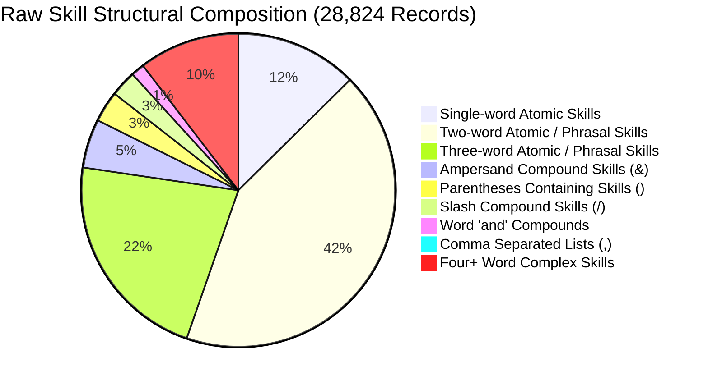
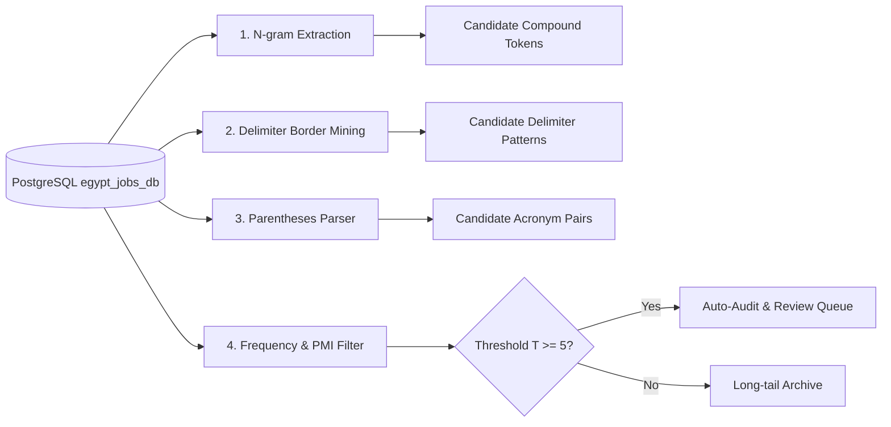

# Unified Technical Implementation Plan
## Atomic Skill Decomposition & Linguistic Pattern Intelligence Engine

**Project:** Hire Q - Egyptian Career Intelligence Architecture  
**Database:** PostgreSQL `localhost:5432/egypt_jobs_db`  
**Dataset Universe:** 464,397 Job Skills Records | 28,824 Unique Raw Skills  
**Reference Taxonomy:** 3,794 Canonical Skills (14 Closed Domains, 61 Subcategories)  
**Status:** Audit & Architecture Phase (Zero Code Execution until Approved)

---

## 1. Repository & Database Forensic Audit (Verified Facts)

### 1.1 Database State (`egypt_jobs_db`)
Direct SQL inspection of the live PostgreSQL database confirmed the following exact table schemas and record counts:

| Table Name | Live Row Count | Primary Key | Critical Fields Inspected |
|---|---|---|---|
| `skills` | **28,824** | `id` (UUID) | `name` (raw text), `domain`, `sub_category`, `normalized_name`, `skill_type` |
| `job_skills` | **464,397** | Composite (`job_id`, `skill_id`) | `raw_skill_text`, `skill_level`, `confidence`, `is_required`, `skill_type` |
| `jobs` | **52,128** | `id` (UUID) | `title_raw`, `title_normalized`, `company_name`, `job_category`, `status` |
| `skill_aliases` | **30,631** | `id` (Int) | `skill_id` (UUID), `alias_name` (Text) |
| `skill_tool_relationships` | **5,175** | `id` (Int) | `tool_name`, `related_skill`, `co_occurrence_count`, `confidence` |
| `skill_embeddings` | **28,740** | `id` (UUID) | Vector embeddings for semantic search |

> [!NOTE]
> All 28,824 skill records in `skills.csv` are in English/Latin script. In the raw scraper table `job_skills`, only 198 records (0.04%) contain Arabic script (`raw_skill_text`). However, bilingual coverage (English + Arabic synonyms) is preserved in `standard_skills_catalog.csv` (regex patterns) and `standard_skill_levels_matrix.csv`.

### 1.2 Existing File Inventory & Audit Findings

| Existing File | Lines / Size | Current Functionality | Audit Findings & Deficiencies |
|---|---|---|---|
| `scratch/atomic_decomposition_engine.py` | 518 lines | Monolithic prototype decomposition engine. | • Contains static, hardcoded lists embedded in code.<br>• Only 26 protected compounds, 36 short tokens, 23 noise tokens.<br>• Does not leverage `skills_acronym_dictionary.json` (386 entries).<br>• Lacks category container awareness (e.g. `AI Tools (Claude, ChatGPT)`). |
| `standard_skills_catalog.csv` | 3,794 rows (1.74 MB) | Closed 14/61 taxonomy reference with regexes. | • Delimiter is `;`, UTF-8-sig.<br>• Row 2521 had over-eager regex branch (`|IT`) which was audited and fixed.<br>• Verified zero false-positive matches on 30 common generic words. |
| `standard_skill_levels_matrix.csv` | 23 rows (3.8 KB) | Level matrix with regexes & Arabic patterns. | • Covers 5 skill types (Hard Skill, Tool, Language, Cert, Soft Skill).<br>• Rank orders from 0 to 6 (CEFR levels for languages A1-C2). |
| `skills_acronym_dictionary.json` | 386 entries (128 KB) | Curated global & Egyptian tech acronyms. | • Fully vetted with canonical names, domains, and subcategories.<br>• Currently sitting idle; must be integrated directly into the engine. |
| `run_full_atomic_decomposition.py` | 117 lines | Batch execution wrapper with DB frequency join. | • Uses synchronous batching; needs modular decoupling from the core engine. |

---

## 2. Linguistic Pattern Analysis on Raw Skills (28,824 Records)

Empirical pattern scanning across all 28,824 raw skill records revealed the following structural distribution:



### 2.1 Delimiter Breakdown
- **Ampersand (`&`) (1,654 skills - 5.7%):**
  - Symmetric tech pairs: `Networking & ICT Infrastructure`, `Aluminum & Glazing`.
  - Level-modified compounds: `ERP & Advanced Excel`, `Shop Drawings & RFI Management`.
  - Conceptual pairs: `Capacity Planning & Risk Management`, `Digital Transformation & BI`.
- **Parentheses (`()`) (1,053 skills - 3.6%):**
  - Acronym definitions: `Building Information Modeling (BIM)` (16), `Computer Vision (CV)` (9), `Artificial Intelligence (AI)` (7), `Warehouse Management System (WMS)` (5).
  - Concrete tool specifications: `4D Simulation (Synchro 4D, Navisworks)`, `AI Tools (Claude, ChatGPT)`, `Caching (Redis, Memcached)`.
  - Domain restrictions: `Sales Experience (Transportation & Logistics)`, `Accounting Experience (Hospitality/Leisure)`.
  - Level-only modifiers: `Microsoft Office (Advanced)`, `Java (Senior)`.
- **Slash (`/`) (883 skills - 3.1%):**
  - Protected compound tokens: `PL/SQL`, `CI/CD`, `UI/UX`, `C/C++`, `I/O`.
  - Dual certification credentials: `CFA/FRM Certifications`, `PGCE/QTS Certification`.
  - Dual technical domains: `Azure IaaS/PaaS`, `High-availability/DR design`, `Civil/Structural Engineering`.
  - Egyptian import/export regulations: `CargoX/ACID/Form 4 Documentation`.
- **Comma (`,`) (252 skills - 0.9%):**
  - Comma-delimited tool stacks: `Observe.AI, CallMiner, NICE`, `AutoCAD, Revit, Microsoft Office`.
  - Comma-delimited skill clusters: `Analytical Thinking, Attention to Detail, Research`, `ETL, data modeling, data warehousing`.
  - Numbered regulatory lists: `Forms 1, 2, 6`.

---

## 3. Gap Analysis: Missing Vocabulary & Linguistic Patterns

Comparing the existing prototype against the unified specification identifies the following critical omissions:

### 3.1 Missing Vocabulary Categories
1. **Egyptian Market Regulatory & Legal Terminology:**
   - Customs & Trade: `CargoX`, `ACID`, `Form 4`, `Nafeza`, `Single Window`.
   - Social Insurance & Labor Law: `Form 1`, `Form 2`, `Form 6`, `Labor Law 12/2003`.
   - Tax Authority: `ETA`, `E-Invoicing`, `E-Receipt`, `Withholding Tax`.
2. **Missing Industrial & Hardware Protected Compounds:**
   - Telecom / RF: `GSM/CDMA`, `RF/Microwave`, `2G/3G/4G/5G`, `HV/MV/LV`, `OT/IT`.
   - Manufacturing / Automation: `PLC/SCADA`, `BMS/HVAC`, `PCB/PCBA`, `FPGA/ASIC`, `DCS/ESD`.
   - Quality & Medical: `GCP/GLP`, `QA/QC`, `ICU/CCU`, `NICU`, `CBC/PCR`.
   - Corporate / Legal: `KYC/AML`, `SIT/UAT`, `IFRS/IAS`, `POS/EFT`.
3. **Intrinsic "Level-Word" Proper Nouns (False-Positive Level Traps):**
   - In sales/marketing: `Lead Generation`, `Lead Nurturing`, `Lead Scoring`, `Lead Management` (the word `Lead` refers to a sales prospect, NOT a team lead!).
   - In healthcare: `Senior Care`, `Senior Living`, `Elder Care` (`Senior` refers to elderly patients!).
   - In cybersecurity/networking: `Advanced Threat Protection`, `Advanced Routing`.
4. **Category Containers / Header Wrappers:**
   - Suffix wrappers: `AI Development Tools (Claude Code, Codex)` -> `AI Development Tools` is a container header.
   - Experiential wrappers: `Sales Experience (Transportation & Logistics)` -> `Sales Experience` is a competency wrapper.

---

## 4. Specification Reconciliation & Conflict Resolutions

| # | Conflict / Ambiguity Point | Specification 1 (Decomposition & Graph) | Specification 2 (Linguistic Intelligence) | Reconciled Architectural Decision |
|---|---|---|---|---|
| 1 | **Category Container Headers** | Decomposes everything into atomic rows. | Recognizes that phrases like `AI Tools (...)` are category wrappers. | **Keep Header as Context Parent:** Emit the concrete child tools as atomic rows; capture the container in `separated_from_before = 'AI Tools'` and `separated_by = '()'`. If the container itself has market value, emit a primary category row. |
| 2 | **Acronym Detection Mechanism** | Uses initials matching: `w[0] for w in before`. | Requires mapping known synonyms and non-initial acronyms (e.g. `K8s` -> Kubernetes, `GCP` -> Google Cloud). | **Dual Acronym Engine:** 1) First check against `skills_acronym_dictionary.json` (386 vetted pairs); 2) If not in dictionary, apply initials heuristic rule. |
| 3 | **The Word "Lead" and "Senior"** | Strips `Lead` and `Senior` into `skill_level`. | Recognizes `Lead Generation` (Sales) and `Senior Care` (Healthcare) as atomic domain skills. | **Contextual Disambiguation Whitelist:** Protect compounds where `Lead` is followed by `Generation/Nurturing/Management/Scoring`, or `Senior` followed by `Care/Living`. In these cases, do NOT strip into level. |
| 4 | **Numbered Regulatory Lists (`Forms 1, 2, 6`)** | Delimiter splitting on comma yields `Forms 1`, `2`, `6`. Tokens `2` and `6` get rejected as noise. | Recognizes Egyptian Social Insurance forms as a cohesive regulatory standard. | **Pre-split Regex Consolidation:** Pre-match regulatory patterns `Forms?\s*\d+(?:\s*,\s*\d+)*` and normalize to `Egyptian Social Insurance (Forms 1, 2, 6)` before delimiter splitting. |
| 5 | **Slash (/) Dual Semantics** | Slashes are treated as delimiters to split. | Slashes represent unbreakable atomic standards (`PL/SQL`, `CI/CD`). | **Strict Whitelist Masking:** All protected compounds are masked to safe placeholders (`PL_SQL`) prior to regex delimiter splitting, then restored. |

---

## 5. Proposed Modular Architecture & Directory Structure

To ensure clean separation of concerns, testability, and zero hallucination, the engine will be refactored from a monolithic script into a modular architecture:

```
d:\Hire Q Project\
├── linguistic_intelligence/
│   ├── __init__.py
│   ├── config.py                          # Global paths, DB credentials, thresholds
│   │
│   ├── vocabularies/                      # Decoupled, audited JSON lexicons
│   │   ├── __init__.py
│   │   ├── protected_compounds.json        # 50+ compounds (PL/SQL, CI/CD, UI/UX, etc.)
│   │   ├── protected_proper_nouns.json     # ADAS, ABAP, Lead Generation, Senior Care
│   │   ├── valid_short_tokens.json        # 50+ tokens (2G, 3G, BI, AI, ML, R, C, etc.)
│   │   ├── acronym_dictionary.json        # 400+ verified global & Egyptian acronyms
│   │   ├── redundant_suffixes.json        # skills, tools, technologies, suite, level
│   │   ├── noise_tokens.json              # editions, levels, basics, functions, etc.
│   │   ├── languages_catalog.json         # 30+ languages with CEFR mapping
│   │   ├── soft_skills_catalog.json       # 50+ closed soft skills
│   │   ├── certifications_catalog.json    # Global & regional certification patterns
│   │   └── egyptian_regulatory_terms.json # CargoX, ACID, Form 1/2/6, ETA, E-Receipt
│   │
│   ├── patterns/                          # Compiled regex engines
│   │   ├── __init__.py
│   │   ├── delimiters.py                  # Delimiters: /, &, ,, -, +, and, or
│   │   ├── levels.py                      # Multi-tier level extraction (Ranks 1-6)
│   │   ├── parentheses.py                 # Typology engine (Level vs Acronym vs Spec)
│   │   └── containers.py                  # Category container & header parsers
│   │
│   ├── engine/                            # Core decomposition & graph linking
│   │   ├── __init__.py
│   │   ├── catalog_matcher.py             # Layer 1 regex & exact catalog matcher
│   │   ├── atomic_decomposer.py           # 5-pass sequential pipeline
│   │   └── graph_builder.py               # Bidirectional relational graph linker
│   │
│   ├── discovery/                         # Automated empirical DB discovery
│   │   ├── __init__.py
│   │   ├── database_miner.py              # Mines n-grams & acronyms from PostgreSQL
│   │   └── pattern_auditor.py             # Audits regex bleed and false positives
│   │
│   └── tests/                             # Comprehensive test suite
│       ├── __init__.py
│       ├── test_benchmark_cases.py        # 12 mandatory user benchmark cases
│       ├── test_parentheses_typology.py   # Regression suite on all 1,053 parens skills
│       ├── test_slash_compounds.py        # Regression suite on all 883 slash skills
│       └── test_regex_bleed.py            # Word-boundary false-positive verification
```

---

## 6. Empirical Database Discovery Protocol

Rather than manually guessing vocabulary, the `discovery/database_miner.py` module will interrogate PostgreSQL `egypt_jobs_db`:



1. **Delimiter Border Mining:** Query all skills with `/`, `&`, `,`, `-` and extract word tokens on immediate left and right boundaries with frequency $\ge 5$.
2. **Parenthesis Alias Mining:** Extract all `(text)` occurrences. If `text` matches initials of preceding words, automatically append to `acronym_dictionary.json`.
3. **PMI Collocation Mining:** Compute Pointwise Mutual Information on 2-word and 3-word combinations across 464,397 `raw_skill_text` records to automatically detect unbreakable technical phrases.
4. **Short-Token Safety Harvesting:** Extract all $\le 3$-character tokens with frequency $\ge 5$ in `job_skills` (e.g. `BOM`, `BMS`, `WMS`, `POS`, `ERP`) to guarantee they are never falsely rejected by length filters.

---

## 7. Strict Processing Order & Rule Precedence Hierarchy

Every skill string must pass through this exact 10-step mathematical precedence pipeline:

```
┌─────────────────────────────────────────────────────────────────────────────┐
│ STEP 1: Unicode Normalization (NFKC, strip non-printable, collapse spaces)  │
└──────────────────────────────────────┬──────────────────────────────────────┘
                                       ▼
┌─────────────────────────────────────────────────────────────────────────────┐
│ STEP 2: Protected Proper Nouns Check (ADAS, ABAP, Lead Generation, etc.)    │
│         -> If matched: FREEZE from level stripping and delimiter splitting   │
└──────────────────────────────────────┬──────────────────────────────────────┘
                                       ▼
┌─────────────────────────────────────────────────────────────────────────────┐
│ STEP 3: Parentheses Typology Engine                                         │
│         -> Case A: Level-Only (e.g. (Advanced)) -> extract lvl, strip parens│
│         -> Case B: Acronym (e.g. (AWS)) -> record alias, strip parens       │
│         -> Case C: Regulatory Form (Forms 1, 2, 6) -> consolidate format    │
│         -> Case D: Sub-skill / Specification -> fork main row and child rows│
└──────────────────────────────────────┬──────────────────────────────────────┘
                                       ▼
┌─────────────────────────────────────────────────────────────────────────────┐
│ STEP 4: Standalone Catalog Match (No Delimiters, e.g. Data Analysis)        │
│         -> If matched: emit single intact canonical row                     │
└──────────────────────────────────────┬──────────────────────────────────────┘
                                       ▼
┌─────────────────────────────────────────────────────────────────────────────┐
│ STEP 5: Protected Compound Masking (PL/SQL -> PL_SQL, CI/CD -> CI_CD)       │
└──────────────────────────────────────┬──────────────────────────────────────┘
                                       ▼
┌─────────────────────────────────────────────────────────────────────────────┐
│ STEP 6: Hierarchical Delimiter Splitting (1: &, and | 2: / | 3: , | 4: -)    │
└──────────────────────────────────────┬──────────────────────────────────────┘
                                       ▼
┌─────────────────────────────────────────────────────────────────────────────┐
│ STEP 7: Per-Chunk Cleaning & Suffix Stripping                               │
│         -> Unmask protected compounds                                       │
│         -> Extract chunk-specific level modifier (NEVER bleed across chunks)│
│         -> Strip redundant suffixes (skills, tools, technologies, suite)     │
│         -> Strip edge punctuation                                           │
└──────────────────────────────────────┬──────────────────────────────────────┘
                                       ▼
┌─────────────────────────────────────────────────────────────────────────────┐
│ STEP 8: Noise Filtering & Short Token Validation                            │
│         -> If token in NOISE_TOKENS or (len <= 2 and not in VALID_SHORT):   │
│            Emit REJECTED_NOISE with explicit reason                         │
└──────────────────────────────────────┬──────────────────────────────────────┘
                                       ▼
┌─────────────────────────────────────────────────────────────────────────────┐
│ STEP 9: Catalog Mapping & Deterministic Taxonomy Classification             │
│         -> Standard catalog match -> inherit domain, subcategory, skill_type │
│         -> Languages lexicon -> General Business / Languages & Translation  │
│         -> Soft Skills lexicon -> General Business / Interpersonal Skills   │
│         -> Certifications lexicon -> Certification                          │
│         -> Unmatched novel -> Mark UNMATCHED_NOVEL                          │
└──────────────────────────────────────┬──────────────────────────────────────┘
                                       ▼
┌─────────────────────────────────────────────────────────────────────────────┐
│ STEP 10: Bidirectional Relational Graph Construction                        │
│          -> Set separated_by, separated_from_before, separated_from_after    │
└─────────────────────────────────────────────────────────────────────────────┘
```

---

## 8. Specific Ambiguous Cases Requiring User Decision

Before finalizing the implementation, we have identified 5 specific ambiguous categories in the real dataset that require your explicit decision:

### Decision Case 1: Category Container Headers
- **Example in Data:** `AI Development Tools (Claude Code, Codex)` or `Caching (Redis, Memcached)`.
- **Option A (Leaf Skills Only):** Extract only `Claude Code` and `Codex` as atomic skills; discard the wrapper `AI Development Tools`.
- **Option B (Preserve Container as Graph Parent - Recommended):** Emit `AI Development Tools` as a primary row (`Tool / Software`), and emit `Claude Code` and `Codex` as child rows with `separated_from_before = 'AI Development Tools'` and `separated_by = '()'`.
- *Which option do you prefer?*

### Decision Case 2: Parenthetical Industry Context Restrictions
- **Example in Data:** `Sales Experience (Transportation & Logistics)` or `Accounting Experience (Hospitality/Leisure)`.
- `Transportation & Logistics` and `Hospitality/Leisure` are not skills; they are industry sector restrictions.
- **Option A:** Extract `Transportation & Logistics` as a child skill row anyway.
- **Option B (Recommended):** Strip the parenthetical industry context from the atomic skill name (`Sales Experience` -> `Sales`), and store `Transportation & Logistics` in an optional `industry_restriction` column so it doesn't pollute the skills catalog.
- *Which option do you prefer?*

### Decision Case 3: Dual Multi-Discipline Specializations
- **Example in Data:** `Civil/Structural Engineering`, `Electrical/Electronics Engineering`.
- Both sides of the slash are parts of the same professional discipline.
- **Option A:** Split into 2 rows: `Civil Engineering` and `Structural Engineering`.
- **Option B:** Map directly to the canonical standard skill `Civil & Structural Engineering` in the catalog as 1 row.
- *Which option do you prefer?*

### Decision Case 4: Dual Product / Stack Dependencies
- **Example in Data:** `GitHub Actions/GitHub Advanced Security`.
- **Option A:** Row 1: `GitHub Actions`, Row 2: `GitHub Advanced Security` (with level `Advanced`).
- **Option B:** Row 1: `GitHub Actions`, Row 2: `GitHub` (with level `Advanced` and `separated_from_after = 'Security'`).
- *Which option do you prefer?*

---

## 9. Test Strategy & Acceptance Criteria

### 9.1 The 12 Mandatory Benchmark Acceptance Cases
The implementation will only be considered successful if 100% of these 12 cases pass exact automated assertions:

| # | Raw Input Skill | Expected Atomic Skills | Expected Delimiter | Expected Level | Expected Type | Expected Status |
|---|---|---|---|---|---|---|
| 1 | `Advanced Excel (Cost & Quantity Tracking)` | `Microsoft Excel`<br>`Cost`<br>`Quantity Tracking` | `()`<br>`&`<br>`&` | `Advanced`<br>`Not Specified`<br>`Not Specified` | `Tool / Software`<br>`Hard Skill`<br>`Hard Skill` | `CATALOG_EXACT_MATCH`<br>`PARENTHESIS_SPECIFICATION`<br>`PARENTHESIS_SPECIFICATION` |
| 2 | `Advanced Excel skills` | `Microsoft Excel` | `None` | `Advanced` | `Tool / Software` | `CATALOG_EXACT_MATCH` |
| 3 | `ERP & Advanced Excel` | `ERP Systems`<br>`Microsoft Excel` | `&`<br>`&` | `Not Specified`<br>`Advanced` | `Tool / Software`<br>`Tool / Software` | `CATALOG_EXACT_MATCH`<br>`CATALOG_EXACT_MATCH` |
| 4 | `Microsoft Office Suite Advanced` | `Microsoft Office` | `None` | `Advanced` | `Tool / Software` | `CATALOG_EXACT_MATCH` |
| 5 | `ISTQB Advanced Level` | `ISTQB` | `space` | `Advanced` | `Certification` | `UNMATCHED_NOVEL` |
| 6 | `Advanced Editions` | `Editions` | `None` | `Advanced` | `Requirement` | `REJECTED_NOISE` (`Incomplete fragment: Editions`) |
| 7 | `Microsoft Office (Advanced)` | `Microsoft Office` | `()` | `Advanced` | `Tool / Software` | `CATALOG_EXACT_MATCH` (0 duplicate rows) |
| 8 | `Amazon Web Services (AWS) - Advanced` | `AWS` | `()` | `Advanced` | `Tool / Software` | `CATALOG_EXACT_MATCH` (0 duplicate rows) |
| 9 | `PL/SQL (Advanced Development & Performance Tuning)` | `Oracle Database`<br>`Development`<br>`Performance Tuning` | `()`<br>`&`<br>`&` | `Not Specified`<br>`Advanced`<br>`Not Specified` | `Tool / Software`<br>`Hard Skill`<br>`Hard Skill` | `CATALOG_EXACT_MATCH`<br>`PARENTHESIS_SPECIFICATION`<br>`PARENTHESIS_SPECIFICATION` |
| 10 | `GitHub Actions/GitHub Advanced Security` | `GitHub Actions`<br>`GitHub Advanced Security` | `/`<br>`/` | `Not Specified`<br>`Advanced` | `Tool / Software`<br>`Tool / Software` | `CATALOG_EXACT_MATCH`<br>`CATALOG_REGEX_MATCH` |
| 11 | `Data Analysis` | `Data Analysis` | `None` | `Not Specified` | `Hard Skill` | `CATALOG_EXACT_MATCH` (Never split on space) |
| 12 | `Python/Bash/Go` | `Python`<br>`Bash`<br>`Go` | `/`<br>`/`<br>`/` | `Not Specified`<br>`Not Specified`<br>`Not Specified` | `Tool / Software`<br>`Tool / Software`<br>`Tool / Software` | `CATALOG_EXACT_MATCH` (Go never rejected by length) |

### 9.2 Full Dataset Acceptance Gates
1. **Zero Runtime Exceptions:** 28,824 raw skills must process completely in $< 4$ minutes.
2. **Zero Taxonomy Bleed:** 100% of validated skills must map strictly to one of the 14 Domains and 61 Subcategories.
3. **Graph Integrity Assertion:** Every compound skill must exhibit exact mathematical symmetry: `separated_from_before` of child $N$ must contain token $N-1$, and `separated_from_after` of child $N$ must contain token $N+1$.
4. **Noise Rejection Accuracy:** Meaningless fragments (`Editions`, `Levels`, `Suite`, `Basics`, single invalid characters) must be 100% trapped and rejected with clear explanations.

---

## 10. Next Steps (Awaiting User Review & Approval)

In strict adherence to your instructions, **no implementation code will be written or modified** until you review this plan.

Please review the **4 Ambiguous Decision Points** in Section 8:
1. Category Containers: Keep as graph parents (Option B) or extract leaf tools only (Option A)?
2. Industry Contexts in parens: Move to metadata column (Option B) or treat as child skills (Option A)?
3. Dual disciplines (`Civil/Structural`): Split into 2 skills (Option A) or map to standard canonical (Option B)?
4. Product dependencies (`GitHub Advanced Security`): Keep full product name (Option A) or split (Option B)?

Once you approve this plan and provide your preferences on these decisions, we will begin implementation according to the approved architecture.
