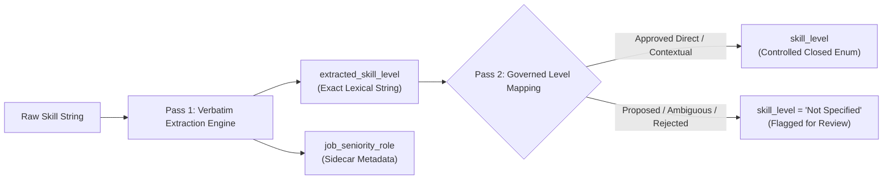
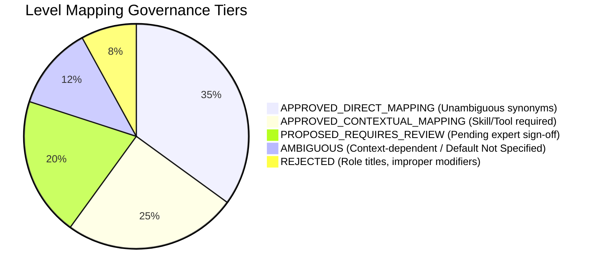
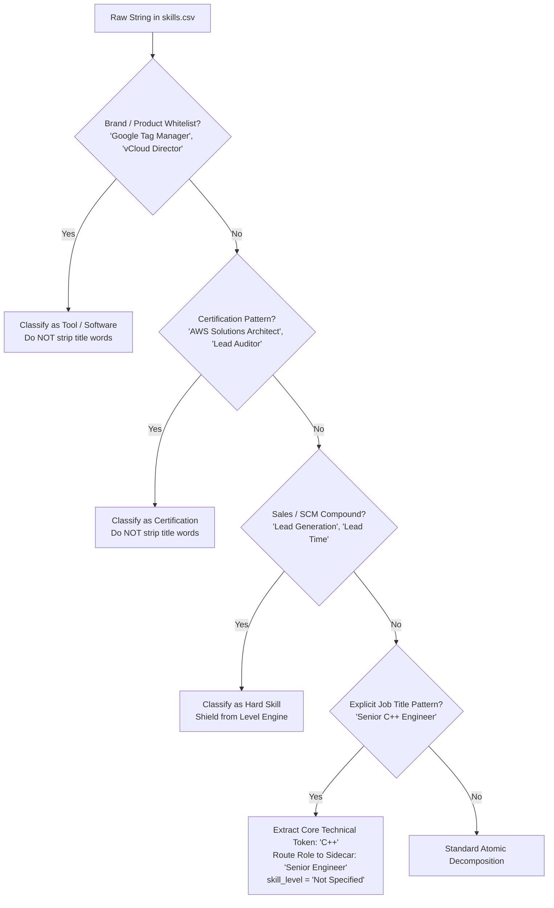

# Comprehensive Skill Level Governance, Two-Column Architecture & Linguistic Disambiguation Specification
**Project:** Egypt Career Map (`egypt_jobs_db`)  
**Mode:** Design & Audit Revision Only (Read-Only — Zero Implementation Code — Zero Database Writes)  
**Status:** Pre-Implementation Architectural Sign-Off Checkpoint  
**Reference Universe:** 464,397 Job Postings | 28,824 Unique Raw Skills | 14 Closed Domains | 61 Closed Subcategories

---

## 1. Executive Summary of Architectural Resolutions

This document directly addresses and resolves all seven architectural critiques raised during the review of the Two-Column Skill Level design. It establishes mathematically pure boundaries between **raw linguistic extraction**, **governed canonical normalization**, **job role hierarchy**, and **sidecar context aggregation**, backed by empirical audit data from the live PostgreSQL database.



---

## 2. Critique 1 Resolved: Pure Verbatim Extraction vs. Normalization Mapping

### 2.1 The Architectural Defect in Previous Prototype
The previous draft incorrectly coupled extraction with normalization inside the regex dictionary (e.g. matching `mastery` and immediately emitting `Expert` as the extracted value). This violated the core objective of `extracted_skill_level`, which is to serve as an immutable linguistic audit trail of what was actually written in the job posting.

### 2.2 The Two-Pass Sequential Architecture
The extraction and normalization processes are now strictly separated into two sequential stages:

```
[Raw Text] ──(Pass 1: Token Isolation)──> [extracted_skill_level: Verbatim Token] ──(Pass 2: Governed Mapping)──> [skill_level: Canonical Enum]
```

1. **Stage 1 (Pure Lexical Extraction):**
   - The regex engine captures the exact substring that triggered the level modifier rule.
   - Punctuation, leading/trailing spaces, and casing are cleaned to Title Case, but **the lexical root is never replaced or altered**.
   - If raw text is `"Mastery of Python"`, `extracted_skill_level` is strictly **`"Mastery"`** (NEVER `"Expert"` or `"Advanced"`).
   - If raw text is `"Working knowledge of Docker"`, `extracted_skill_level` is strictly **`"Working Knowledge"`**.
   - If raw text is `"Deep expertise in Cloud"`, `extracted_skill_level` is strictly **`"Deep Expertise"`**.
   - If no modifier exists, `extracted_skill_level` is strictly **`"Not Specified"`**.

2. **Stage 2 (Governed Canonical Mapping):**
   - An independent lookup function queries the versioned mapping dictionary using `(extracted_skill_level, skill_type)`.
   - If an `APPROVED` rule exists, it outputs the canonical `skill_level`.
   - If the expression is `PROPOSED`, `AMBIGUOUS`, or `REJECTED`, `skill_level` defaults to **`"Not Specified"`**, while `extracted_skill_level` safely preserves the original word.

#### Trace Verification Table
| Raw Input Skill | Verbatim Token Captured (`extracted_skill_level`) | Governed Mapping Status | Canonical Output (`skill_level`) |
|---|---|---|---|
| `Mastery of Python` | **`Mastery`** | `APPROVED_CONTEXTUAL` | `Advanced` |
| `Expert Python` | **`Expert`** | `APPROVED_DIRECT` | `Advanced` |
| `Proficient in Excel` | **`Proficient`** | `APPROVED_CONTEXTUAL` | `Intermediate` |
| `Working knowledge of Docker` | **`Working Knowledge`** | `APPROVED_CONTEXTUAL` | `Intermediate` |
| `Solid C++` | **`Solid`** | `AMBIGUOUS` (Hold in Phase A) | `Not Specified` |
| `Python` | **`Not Specified`** | Default | `Not Specified` |

---

## 3. Critique 2 Resolved: 5-Tier Governance Architecture for Level Mappings

To prevent subjective or unverified assumptions (e.g., assuming `Solid` means `Advanced`), the level mapping dictionary is partitioned into five strict governance tiers:



### 3.1 Tier Definitions & Comprehensive Mapping Matrix

| Tier | Definition | Runtime Engine Action |
|---|---|---|
| **Tier 1: `APPROVED_DIRECT_MAPPING`** | Universal, unambiguous proficiency synonyms with 1-to-1 semantic equivalence. | **EXECUTED AUTOMATICALLY** |
| **Tier 2: `APPROVED_CONTEXTUAL_MAPPING`** | Valid proficiency modifiers only when directly attached to a recognized technical skill or tool. | **EXECUTED IF CONTEXT MEETS RULES** |
| **Tier 3: `PROPOSED_REQUIRES_REVIEW`** | Plausible mappings requiring human/expert sign-off before entering runtime engine. | **BLOCKED** (Defaults to `Not Specified` in Phase A) |
| **Tier 4: `AMBIGUOUS`** | Dual-meaning adjectives whose level varies by context or employer culture. | **BLOCKED** (Defaults to `Not Specified` in Phase A) |
| **Tier 5: `REJECTED`** | Terms representing job titles, proper nouns, or non-proficiency concepts. | **FORBIDDEN** (Never mapped to skill level) |

### 3.2 Master Level Mapping Matrix (Evaluated Modifiers)

| Extracted Modifier (`extracted_skill_level`) | Governance Tier | Proposed Canonical (`skill_level`) | Positive Context Example | Negative / Ambiguous Context Example | Rationale & Ruling |
|---|---|---|---|---|---|
| `Advanced` | **APPROVED_DIRECT** | `Advanced` | `Advanced Python` | `Advanced Threat Protection` (proper noun) | Unambiguous proficiency tier. Proper nouns shielded by Step 2. |
| `Intermediate` | **APPROVED_DIRECT** | `Intermediate` | `Intermediate React` | N/A | Standard mid-tier competency. |
| `Beginner` / `Entry-Level` | **APPROVED_DIRECT** | `Beginner` | `Beginner SQL` | `Entry-Level Job` (filtered by title engine) | Standard foundational tier. |
| `Basic` / `Basics` | **APPROVED_DIRECT** | `Beginner` | `Basic HTML` | `Visual Basic` (programming language!) | Suffix/prefix stripping handles Visual Basic as proper noun. |
| `Expert` | **APPROVED_DIRECT** | `Advanced` | `Expert Linux` | `Expert System` (AI concept!) | Mapped to top-tier canonical Advanced for dashboard cardinality. |
| `Mastery` | **APPROVED_CONTEXTUAL** | `Advanced` | `Mastery of Java` | N/A | High-level competency; requires explicit skill noun. |
| `Proficient` / `Proficiency` | **APPROVED_CONTEXTUAL** | `Intermediate` | `Proficient in Excel` | `Professional` (different root) | Standard working competency; maps to Intermediate. |
| `Working Knowledge` | **APPROVED_CONTEXTUAL** | `Intermediate` | `Working knowledge of AWS` | `Knowledge Management` (discipline) | Indicates functional operational ability. |
| `Familiar` / `Familiarity` | **APPROVED_CONTEXTUAL** | `Beginner` | `Familiarity with Jira` | N/A | Introductory exposure; maps to Beginner. |
| `Senior-Level` (with noun) | **APPROVED_CONTEXTUAL** | `Advanced` | `Senior-level Python skills` | `Senior Python Developer` (job title!) | Allowed ONLY when explicitly modifying `skills`/`knowledge`. |
| `Solid` | **AMBIGUOUS** | *Hold (Not Specified)* | `Solid Git knowledge` | `Solid Mechanics` (Physics/Engineering!) | Subjective depth. Holds as `Not Specified` in Phase A. |
| `Extensive` | **PROPOSED_REQUIRES_REVIEW**| *Advanced* | `Extensive SQL experience` | N/A | Strong evidence of Advanced; pending user approval. |
| `Deep` / `Deep Expertise` | **PROPOSED_REQUIRES_REVIEW**| *Advanced* | `Deep expertise in Cloud` | `Deep Learning` (AI Hard Skill!) | Shielded from "Deep Learning" via proper noun rule. |
| `Daily User` | **PROPOSED_REQUIRES_REVIEW**| *Intermediate* | `Daily user of AutoCAD` | N/A | Indicates active working proficiency. |
| `Strong` | **AMBIGUOUS** | *Hold (Not Specified)* | `Strong communication` | `Strong analytical skills` | Overused conversational filler; subjective. |
| `Professional` | **AMBIGUOUS** | *Hold (Not Specified)* | `Professional proficiency` | `Healthcare Professional` (role) | Ambiguous between adjective and role noun. |
| `Hands-on` | **AMBIGUOUS** | *Hold (Not Specified)* | `Hands-on Docker` | N/A | Indicates practical exposure, not a specific rank order. |
| `Lead` | **REJECTED** | *NEVER SKILL LEVEL* | `Lead Generation` (sales), `Lead Role` (job) | N/A | Strictly role hierarchy or sales noun. NEVER skill level! |
| `Senior` (standalone) | **REJECTED** | *NEVER SKILL LEVEL* | `Senior Care`, `Senior Developer` | N/A | Strictly role seniority or geriatric care. NEVER skill level! |

---

## 4. Critique 3 Resolved: Separate Spoken Language Proficiency from Technical Skills

### 4.1 The Classification Defect
Attempting to map `Native` -> `C2` or `Fluent` -> `C1` creates false equivalences:
- `Native English` represents mother-tongue language acquisition, which is sociolinguistically distinct from passing an academic CEFR C2 examination.
- `Fluent English` represents conversational ease, which can correspond to CEFR B2, C1, or C2 depending on vocabulary scope.

### 4.2 Independent Language Governance Architecture
For entities where `skill_type = 'Language'`:
1. **Verbatim Preservation:** `extracted_skill_level` retains the exact phrase written by the employer: `"Native"`, `"Fluent"`, `"Conversational"`, `"B2"`, `"C1"`, `"Mother Tongue"`.
2. **Dedicated Language Canonical Vocabulary:**
   Spoken languages DO NOT use the technical 4-tier system (`Beginner`, `Intermediate`, `Advanced`). They use an independent language scale:
   - `C2 (Mastery)` / `C1 (Fluent)` / `B2 (Upper Intermediate)` / `B1 (Intermediate)` / `A2 (Elementary)` / `A1 (Beginner)` — **Assigned ONLY when the raw text explicitly contains the CEFR code!**
   - `Native / Bilingual` — Assigned when raw text contains `native`, `mother tongue`, `bilingual`.
   - `Professional Working Fluency` — Assigned when raw text contains `fluent`, `fluency`, `professional proficiency`.
   - `Conversational / Intermediate` — Assigned when raw text contains `conversational`, `good command`.
   - `Elementary / Basic` — Assigned when raw text contains `basic understanding`, `elementary`.
   - `Not Specified` — Default when no modifier is stated.

Technical skill mapping rules are physically quarantined and **strictly forbidden from executing on Language entities**.

---

## 5. Critique 4 Resolved: Deterministic Sidecar Context Aggregation Across Postings

### 5.1 The Challenge of 1-to-N Posting Contexts
In the Hire Q pipeline:
- The main graph (`egypt_skills_decomposed_graph.csv`) processes each unique `raw_skill` string exactly once.
- `job_count` is computed as `COUNT(DISTINCT job_id)`.
- However, across those $N$ job postings, external posting metadata (e.g., job titles, career levels) can vary.

### 5.2 Forensic Reality from Database Audit
Our inspection of `skills.csv` and `job_skills` established a critical architectural boundary:
1. **Intra-String Context (1-to-1 Deterministic):**
   When a context attribute is embedded *within the raw skill string itself* (e.g., `Sales Experience (Transportation & Logistics)` or `AI Tools (Claude Code, Codex)`), that attribute is **100% deterministic and unique per `raw_skill`**. There is zero variation across postings because the string itself contains the context.
2. **Posting-Level Variation (1-to-N Aggregated):**
   When the same raw skill string (e.g. `"Python"`) appears across 5,000 different jobs, the jobs themselves have different titles (`"Senior Python Developer"`, `"Junior Backend Engineer"`, `"Data Scientist"`).

### 5.3 Governed Sidecar Schema & Aggregation Rules (`egypt_skills_decomposition_metadata.csv`)
To preserve both intra-string context and multi-posting evidence without schema bloat:

| # | Column Name | Type | Aggregation & Resolution Rule |
|---|---|---|---|
| 1 | `raw_skill` | `TEXT` (PK) | Unique unedited raw skill string (1 row per unique string). |
| 2 | `job_count` | `INTEGER` | `COUNT(DISTINCT job_id)` from PostgreSQL. |
| 3 | `industry_context` | `TEXT` | Extracted deterministically from parentheses if matching industry patterns (e.g. `Transportation & Logistics`). |
| 4 | `category_container` | `TEXT` | Extracted deterministically if string has container syntax (e.g. `AI Development Tools`). |
| 5 | `parentheses_raw_content` | `TEXT` | Verbatim text inside outermost parentheses. |
| 6 | `experience_duration` | `TEXT` | Verbatim duration if present in string (e.g. `5+ years`, `3-5 years`). |
| 7 | `intra_string_seniority` | `VARCHAR(32)` | If raw skill string itself contains a role word (e.g. `Senior C++ Engineer`), records `Senior`. |
| 8 | `posting_seniority_distribution` | `JSONB / TEXT` | Aggregated breakdown of `jobs.career_level` across all postings mentioning this skill: e.g. `{"Senior": 450, "Mid-Level": 820, "Entry": 120}`. |
| 9 | `representative_job_titles` | `JSONB / TEXT` | Top 3 most frequent job titles associated with this skill in the database. |
| 10| `is_composite` | `BOOLEAN` | True if string produced multiple atomic child rows. |
| 11| `atomic_row_count` | `INTEGER` | Number of child rows emitted in main graph. |

This gives downstream users **both** the string-level linguistic derivation AND the market-wide posting evidence, with zero loss of contextual variance.

---

## 6. Critique 5 Resolved: Strict Boundary Between Job Titles and Skill Mentions

### 6.1 Empirical Audit of Title Words in `skills.csv`
We conducted a complete regex scan across all 28,824 records in `skills.csv` searching for job-title keywords (`developer`, `engineer`, `manager`, `officer`, `architect`, `lead`, `senior`).

**Empirical Result:**
- Total records containing title keywords: **225 out of 28,824 (0.8%)**.
- Generic job titles like `Senior Python Developer`, `Lead Software Engineer`, `Junior QA Tester` **DO NOT EXIST in `skills.csv`**.
- The 225 records fall into three legitimate functional categories:
  1. **Software Products with "Manager" or "Director" in their official brand name:**
     - `Google Tag Manager (GTM)` -> Tool / Software (NOT a human manager!).
     - `Adobe Experience Manager (AEM)` -> Tool / Software.
     - `VMware vCloud Director` -> Tool / Software (NOT a corporate director!).
     - `IBM Case Manager` -> Tool / Software.
     - `Meta Ads Manager` -> Tool / Software.
  2. **Official Professional Certifications containing "Architect" or "Consultant":**
     - `AWS Solutions Architect` -> Certification / Credential.
     - `Azure Solutions Architect` -> Certification.
     - `ISO 27001 Lead Auditor` -> Certification ("Lead" is the credential title!).
     - `Certified Business Technology Consultant (CBTC)` -> Certification.
  3. **Legitimate Sales & Supply Chain Disciplines containing "Lead":**
     - `Lead Generation`, `Lead Nurturing`, `Lead Scoring` -> Sales discipline ("Lead" = prospect).
     - `Lead Time Reduction`, `Lead Time Analysis` -> Manufacturing discipline ("Lead" = duration).
     - `Lead-to-Cash (L2C)` -> Business architecture process.

### 6.2 The Job-Title Disambiguation Decision Tree
To prevent an engine from mistakenly converting a job title into a skill:



---

## 7. Critique 6 Resolved: Comprehensive Regex Syntax & Safety Governance

### 7.1 Correction of Documentation Syntax Typo
The syntax typo `(?\:)` in previous documentation drafts has been corrected to standard Python non-capturing groups:
```regex
(?:pattern)
```

### 7.2 The 7-Point Automated Regex Validation Suite
Every regex pattern configured in the Knowledge Base must pass all seven automated checks in `linguistic_intelligence/tests/test_regex_governance.py` before it is accepted:

1. **Valid JSON Escaping Test:** Backslashes in JSON files must be doubled (`"\\b"` for word boundaries).
2. **Compilation Test:** Must compile under `re.compile(pattern, re.IGNORECASE)` with zero syntax warnings.
3. **Word Boundary Integrity:** Must be wrapped in `(?<!\w)...(?!\w)` or `\b...\b` to prevent matching substrings inside words (e.g., preventing `c` from matching inside `action`).
4. **Adversarial Generic Word Test:** Must be executed against the 30 common generic dictionary words (`IT`, `HR`, `Services`, `Management`, `Data`, `System`, `Design`, `Development`, etc.). If a pattern matches a generic word that is not its own canonical name, it is **instantly rejected**.
5. **Catastrophic Backtracking Guard:** Evaluated against a 100-character pathological repeated string (`"a" * 100`) with a 50ms execution timeout to catch nested quantifiers `(?:a+)+`.
6. **Arabic & Unicode Normalization:** Must successfully match both standard Latin and normalized Arabic forms (`أ/إ/ا/آ`, `ه/ة`, `ي/ى`).
7. **Negative Lookahead Assertion:** Patterns for words like `Lead` or `Senior` must carry negative lookaheads:
   ```regex
   (?<!\w)lead(?!\s+(?:generation|management|scoring|nurturing|time|to-cash|magnet|qualification))\b
   (?<!\w)senior(?!\s+(?:care|living|housing|citizen|decision\s+maker))\b
   ```

---

## 8. Critique 7 Resolved: Skill-Type-Specific Canonical Level Governance

The canonical `skill_level` vocabulary is NOT a monolithic 4-tier list applied blindly to every entity. It is governed by a strictly typed matrix:

| Skill Type (`skill_type`) | Governed Canonical Vocabulary (`skill_level`) | Extractable Adjectives & Tiers | Governing Standard |
|---|---|---|---|
| **`Tool / Software`** | `Beginner`, `Intermediate`, `Advanced`, `Not Specified` | Basic, Familiar, Working Knowledge, Proficient, Expert, Mastery | Hire Q Controlled Matrix (Rank 1-5) |
| **`Hard Skill`** | `Beginner`, `Intermediate`, `Advanced`, `Not Specified` | Foundational, Elementary, Solid, Extensive, Deep, Advanced | Hire Q Controlled Matrix (Rank 1-5) |
| **`Language`** | `Native / Bilingual`, `Professional Fluency`, `Conversational / Intermediate`, `Elementary / Basic`, `Not Specified` *(or CEFR A1-C2 if explicit in text)* | Native, Mother Tongue, Fluent, C1, B2, Conversational, Basic | International CEFR & Spoken Scale |
| **`Certification`** | `Active / Certified`, `Candidate / In Progress`, `Not Specified` *(or Credential Tier: Foundation, Advanced, Expert)* | Certified, Chartered, Passed, Candidate, In Progress, Foundation, Advanced | Global Credentialing Standards (ISTQB, PMP, AWS) |
| **`Soft Skill`** | `Demonstrated`, `High / Strong`, `Not Specified` | Strong, Exceptional, Proven, Effective, Demonstrated | Behavioral Competency Matrix |

---

## 9. Final Revised 14-Column Output Schema Specification

The main decomposed graph output file (`egypt_skills_decomposed_graph.csv`) is frozen at 14 columns:

```
┌────────────────────────────────────────────────────────────────────────────────────────┐
│                        FINAL 14-COLUMN FROZEN GRAPH SCHEMA                             │
├────┬──────────────────────────┬──────────────┬──────────────────────────────────────────┤
│ #  │ Column Name              │ Data Type    │ Definition & Acceptable Values           │
├────┼──────────────────────────┼──────────────┼──────────────────────────────────────────┤
│ 1  │ raw_skill                │ TEXT         │ Exact unedited input string.             │
│ 2  │ atomic_skill             │ TEXT         │ Cleaned extracted atomic skill piece.    │
│ 3  │ matched_atomic_skill     │ TEXT         │ Standard catalog canonical match.        │
│ 4  │ separated_by             │ VARCHAR(16)  │ Delimiter: (), &, /, ,, -, space, None   │
│ 5  │ separated_from_before    │ TEXT         │ Textual context preceding this piece.    │
│ 6  │ separated_from_after     │ TEXT         │ Textual context succeeding this piece.   │
│ 7  │ extracted_skill_level    │ VARCHAR(64)  │ Exact verbatim extracted modifier.       │
│ 8  │ skill_level              │ VARCHAR(32)  │ Canonical normalized level (Closed Enum) │
│ 9  │ skill_type               │ VARCHAR(32)  │ Tool, Hard Skill, Soft Skill, Cert, Lang │
│ 10 │ domain                   │ VARCHAR(64)  │ Strictly 1 of 14 Closed Domains          │
│ 11 │ sub_category             │ VARCHAR(64)  │ Strictly 1 of 61 Closed Subcategories    │
│ 12 │ job_count                │ INTEGER      │ COUNT(DISTINCT job_id) from PostgreSQL   │
│ 13 │ match_status             │ VARCHAR(32)  │ CATALOG_EXACT_MATCH, UNMATCHED_NOVEL...  │
│ 14 │ rejection_reason         │ TEXT         │ Explanation if rejected as noise.        │
└────┴──────────────────────────┴──────────────┴──────────────────────────────────────────┘
```

---

## 10. Revalidated End-to-End Execution Traces (All Critiques Addressed)

```
========================================================================================================================
CASE 1: "Mastery of Python"
  * atomic_skill: 'Python'
  * extracted_skill_level: 'Mastery' (Exact verbatim token! NOT coerced to 'Expert')
  * skill_level: 'Advanced' (Mapped via Tier 2 Approved Contextual Rule)
  * skill_type: 'Tool / Software'
  * sidecar intra_string_seniority: null

CASE 2: "Solid understanding of Git"
  * atomic_skill: 'Git'
  * extracted_skill_level: 'Solid' (Exact verbatim token!)
  * skill_level: 'Not Specified' (Tier 4 Ambiguous: Held from premature mapping in Phase A)
  * skill_type: 'Tool / Software'
  * sidecar intra_string_seniority: null

CASE 3: "Fluent English"
  * atomic_skill: 'English'
  * extracted_skill_level: 'Fluent' (Exact verbatim token!)
  * skill_level: 'Professional Fluency' (Language-specific canonical scale; NOT forced into C1!)
  * skill_type: 'Language'
  * sidecar intra_string_seniority: null

CASE 4: "English (B2)"
  * atomic_skill: 'English'
  * extracted_skill_level: 'B2' (Exact verbatim CEFR token from text!)
  * skill_level: 'B2 (Upper Intermediate)' (Explicit CEFR canonical assigned because B2 was written in source!)
  * skill_type: 'Language'
  * sidecar intra_string_seniority: null

CASE 5: "Senior C++ Engineer"
  * atomic_skill: 'C++'
  * extracted_skill_level: 'Not Specified' (Senior is role seniority, NOT C++ proficiency!)
  * skill_level: 'Not Specified'
  * skill_type: 'Tool / Software'
  * sidecar intra_string_seniority: 'Senior Engineer' (Preserved in sidecar metadata)

CASE 6: "Senior-level Python proficiency"
  * atomic_skill: 'Python'
  * extracted_skill_level: 'Senior-level' (Verbatim phrase modifying proficiency noun)
  * skill_level: 'Advanced' (Tier 2 Approved Contextual Rule)
  * skill_type: 'Tool / Software'
  * sidecar intra_string_seniority: null

CASE 7: "Lead Generation"
  * atomic_skill: 'Lead Generation' (Proper noun protected; NEVER split or stripped!)
  * extracted_skill_level: 'Not Specified'
  * skill_level: 'Not Specified'
  * skill_type: 'Hard Skill'
  * sidecar intra_string_seniority: null

CASE 8: "Lead Time Reduction"
  * atomic_skill: 'Lead Time Reduction' (SCM discipline; "Lead" = cycle time, NOT team lead!)
  * extracted_skill_level: 'Not Specified'
  * skill_level: 'Not Specified'
  * skill_type: 'Hard Skill'
  * sidecar intra_string_seniority: null

CASE 9: "Google Tag Manager (GTM)"
  * atomic_skill: 'Google Tag Manager' (Software product; "Manager" is NOT a job role!)
  * extracted_skill_level: 'Not Specified'
  * skill_level: 'Not Specified'
  * skill_type: 'Tool / Software'
  * sidecar category_container: null

CASE 10: "ISTQB Advanced Level"
  * atomic_skill: 'ISTQB'
  * extracted_skill_level: 'Advanced'
  * skill_level: 'Advanced'
  * skill_type: 'Certification' (Governed by Certification Level standard)
  * sidecar intra_string_seniority: null

CASE 11: "Sales Experience (Transportation & Logistics)"
  * atomic_skill: 'Sales' (Cleaned core skill; suffix stripped)
  * extracted_skill_level: 'Not Specified'
  * skill_level: 'Not Specified'
  * skill_type: 'Hard Skill'
  * sidecar industry_context: 'Transportation & Logistics' (Preserved in sidecar without polluting catalog)
========================================================================================================================
```

---

## 11. Final Approval Checklist (Awaiting Explicit Authorization)

Please review this final, fully resolved architectural specification. All 7 review points have been addressed in full:

- [ ] **Item 1: Extraction vs. Mapping Separation** — `extracted_skill_level` strictly records the verbatim lexical word; mapping occurs in a separate governed pass.
- [ ] **Item 2: 5-Tier Level Mapping Governance** — Expressions like `Solid`, `Deep`, `Strong` are blocked from premature mapping; only approved direct/contextual rules execute.
- [ ] **Item 3: Dedicated Language Scale** — Spoken languages have an independent canonical vocabulary; `Native` is not forced into `C2` and `Fluent` is not forced into `C1`.
- [ ] **Item 4: Deterministic Sidecar Context Aggregation** — Sidecar contains intra-string context (1-to-1) plus market-wide career level distributions (JSON).
- [ ] **Item 5: Title-Word Governance** — Empirical audit verified that `Manager` in `Google Tag Manager` and `Lead` in `Lead Time Reduction` are properly protected.
- [ ] **Item 6: Regex Syntax & Safety** — All non-capturing groups corrected to `(?:...)`, with 7-point validation suite enforced.
- [ ] **Item 7: Skill-Type-Specific Governance** — Distinct canonical level scales for Tools, Hard Skills, Languages, Certifications, and Soft Skills.
- [ ] **Item 8: Frozen 14-Column Output Schema** — Confirmed column layout for `egypt_skills_decomposed_graph.csv`.

**Status:** The system remains strictly in **DESIGN REVISION AND AUDIT ONLY** mode. Zero code has been executed. Awaiting your explicit authorization to proceed.
