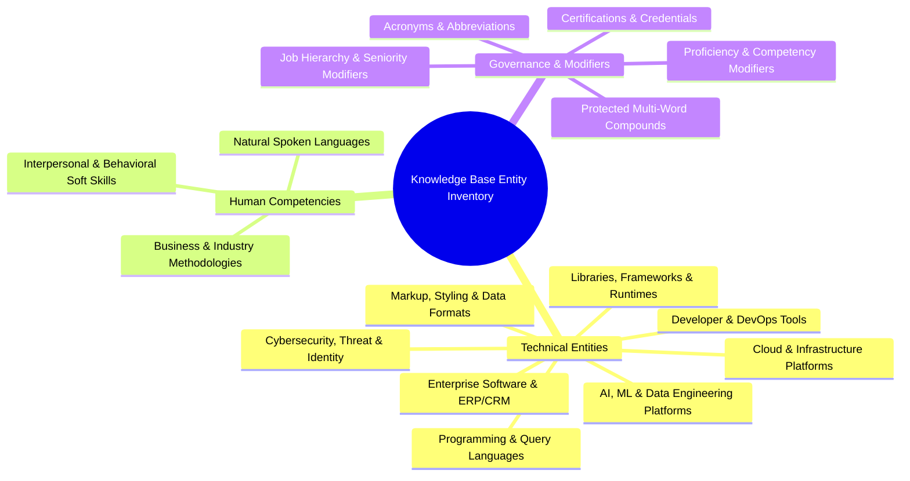
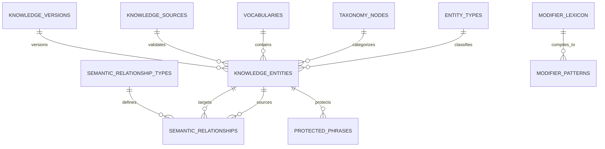
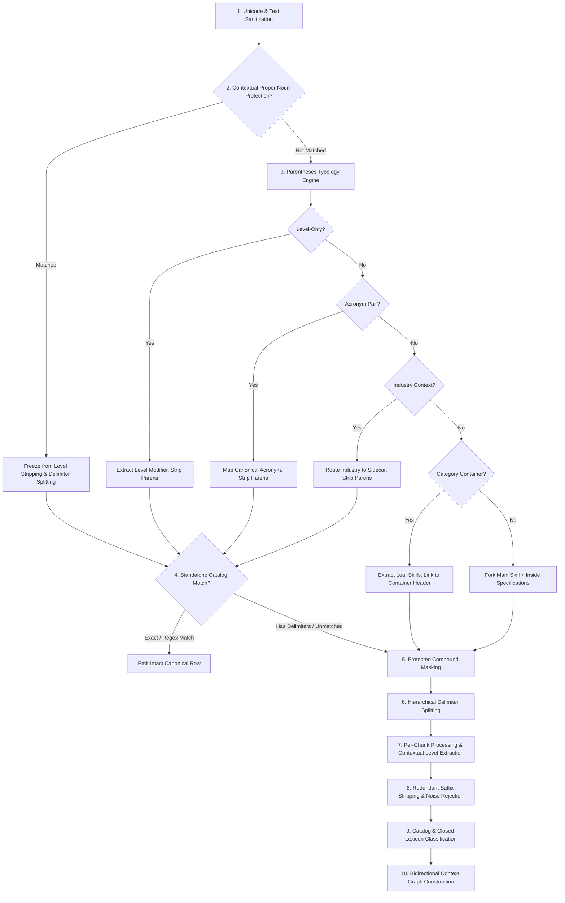
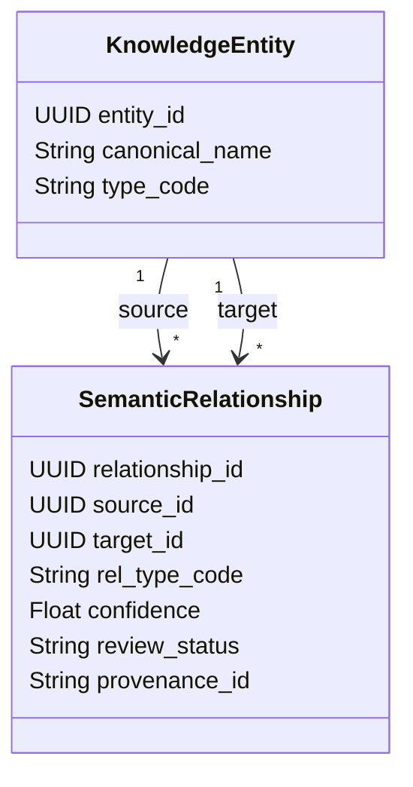
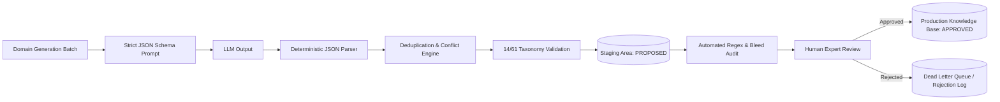
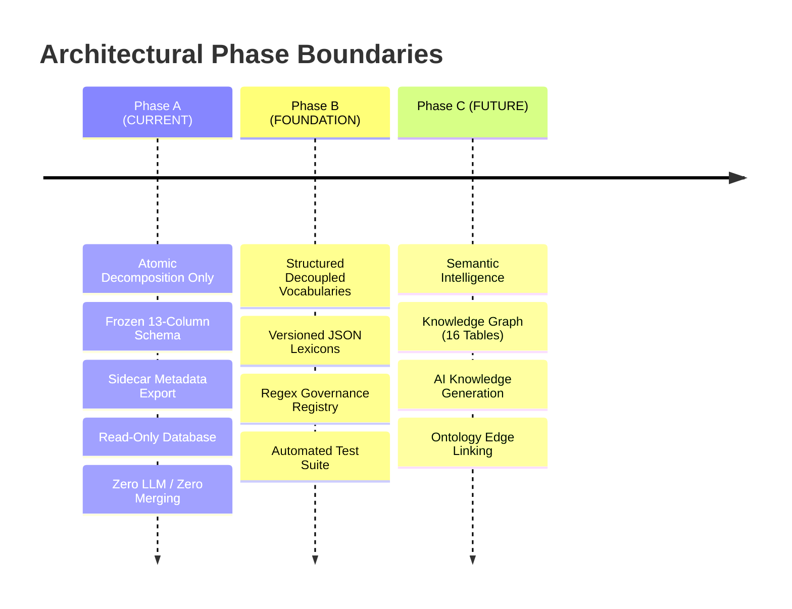

# Deterministic Semantic Skill Intelligence Knowledge Base (DSSIKB)
## Comprehensive Architectural Design, Data Model & Repository Audit
**Project:** Egypt Career Map (`egypt_jobs_db`)  
**Document Type:** Master Design & Verification Checkpoint (Design/Audit Mode — Read-Only — Zero Implementation)  
**Target Engine:** Deterministic Rule & Ontology Pipeline  
**Data Universe:** 464,397 Job Postings | 28,824 Unique Raw Skills | 52,128 Job Listings | 30,631 Skill Aliases  
**Taxonomy Boundary:** 14 Closed Domains | 61 Closed Subcategories (Frozen Catalog Reference)

---

## 1. Verifiable Repository & Database Audit

Every metric, schema, column type, and file citation below was directly verified against the live PostgreSQL instance (`localhost:5432/egypt_jobs_db`) and files in `d:\Hire Q Project`.

### 1.1 Live PostgreSQL Database Audit (`egypt_jobs_db`)

| Table Name | Live Row Count | Primary Key | Key Columns Inspected | Audit Notes & Role in Knowledge Base |
|---|---|---|---|---|
| `skills` | **28,824** | `id` (UUID) | `name` (VARCHAR), `domain` (VARCHAR), `sub_category` (VARCHAR), `normalized_name` (VARCHAR), `created_at` (TIMESTAMPTZ), `skill_type` (VARCHAR) | Contains the deduplicated universe of raw skill strings extracted from job postings. 100% English/Latin script. |
| `job_skills` | **464,397** | Composite (`job_id`, `skill_id`) | `job_id` (UUID), `skill_id` (UUID), `raw_skill_text` (TEXT), `skill_level` (VARCHAR), `confidence` (FLOAT8), `is_required` (BOOL), `source_job_id` (VARCHAR), `skill_type` (VARCHAR) | Represents the empirical unpivoted occurrences of skills across postings. Only 198 records (0.04%) contain Arabic script. Provides true `job_count = COUNT(DISTINCT job_id)`. |
| `jobs` | **52,128** | `id` (UUID) | `title_raw` (TEXT), `title_normalized` (TEXT), `company_name` (VARCHAR), `job_category` (VARCHAR), `career_level` (VARCHAR), `education_level` (VARCHAR), `salary_min` (NUMERIC), `salary_max` (NUMERIC), `status` (VARCHAR) | Core job posting metadata. Matches the data expected in `Jobs.xlsx`. |
| `skill_aliases` | **30,631** | `id` (INT) | `skill_id` (UUID), `alias_name` (TEXT), `created_at` (TIMESTAMPTZ) | High-value relational table linking variants, phrasings, and synonyms directly to skill UUIDs. Essential foundation for entity resolution. |
| `skill_tool_relationships` | **5,175** | `id` (INT) | `tool_name` (VARCHAR), `related_skill` (VARCHAR), `co_occurrence_count` (INT), `confidence` (NUMERIC), `last_seen` (DATE) | Empirical co-occurrence evidence between tools and skills (e.g. `R` with `Deep Learning`, `LSTM`, `Object Detection`). |
| `skill_embeddings` | **28,740** | `id` (UUID) | Vector representations of skills | Semantic vector store used in later stages; frozen during Phase A. |

### 1.2 File Assets Audit

| File Path | Size / Lines | Verification Status | Reusable Knowledge & Gaps Identified |
|---|---|---|---|
| `skills.csv` | 5,586,089 bytes (28,825 lines) | Verified intact | Exact filesystem export of the `skills` table (28,824 rows + header). Corresponds directly to `Skills.xlsx`. |
| `standard_skills_catalog.csv` | 1,736,971 bytes (3,795 lines) | Verified intact (Delimiter: `;`, UTF-8-sig) | 3,794 standard canonical skills mapped to 14 Domains and 61 Subcategories. Contains `standard_skill_name`, `domain`, `sub_category`, `skill_type`, `initial_regex_pattern`, `known_aliases`. **Audited:** Row 2521 had over-eager regex `|IT` which was audited and fixed to `|(?:Services|MRO|IT)[\s\-_/]+Procurement`. |
| `standard_skill_levels_matrix.csv` | 3,796 bytes (24 lines) | Verified intact (Delimiter: `;`, UTF-8-sig) | 23 rows detailing level tiers (Ranks 0 to 6) across Hard Skill, Tool / Software, Language (CEFR A1-C2), Certification, and Soft Skill, with regexes and Arabic patterns. |
| `skills_acronym_dictionary.json` | 127,952 bytes (386 entries) | Verified intact (UTF-8) | 386 vetted acronym definitions with `acronym`, `full_name`, `canonical_skill_name`, `domain`, `sub_category`, `skill_type`, `source`. |
| `skills_acronym_dictionary.csv` | 63,364 bytes (387 lines) | Verified intact | CSV representation of the 386 acronyms. |
| `scratch/atomic_decomposition_engine.py` | 22,759 bytes (518 lines) | Verified prototype | Prototype engine containing embedded static dictionaries (26 protected compounds, 36 short tokens, 23 noise tokens). Needs modular decoupling into the new architecture. |
| `run_full_atomic_decomposition.py` | 4,345 bytes (117 lines) | Verified runner | Read-only database querying runner that computes empirical `COUNT(DISTINCT job_id)` from `job_skills` and passes raw skills through the engine. |

### 1.3 Key Conflicts & Gaps Identified in Existing Knowledge Assets
1. **Acronym Dictionary Disconnect:** `skills_acronym_dictionary.json` has 386 high-quality, verified acronyms, but `scratch/atomic_decomposition_engine.py` was only using an ad-hoc runtime initials-matcher `acronym_cand = ''.join(w[0] for w in words)`. This missed non-initial acronyms like `K8s` (Kubernetes) and `GCP` (when written `Google Cloud`).
2. **Catalog vs Language Reality:** In `standard_skills_catalog.csv`, `Oracle Database` had an overly greedy regex alias that captured `PL/SQL`. Forcing `PL/SQL` to map to `Oracle Database` was a forced alias in the old regex, even though `PL/SQL` is an independent procedural programming language.
3. **Missing Category Container Awareness:** Skills like `AI Development Tools (Claude Code, Codex)` or `Caching (Redis, Memcached)` contain a syntactic container header outside parentheses and concrete instances inside. Without formal container handling, the engine risked either destroying the header or splitting it as an unstructured fragment.
4. **Proper Noun Seniority/Level Collision:** Words like `Lead` and `Senior` were historically at risk of being blindly stripped as proficiency levels, which destroys domain skills like `Lead Generation` (Sales), `Lead Management` (Sales), `Senior Care` (Healthcare), and `Senior Living` (Healthcare).

---

## 2. Knowledge Domain Inventory (16 Granular Domains)

To ensure comprehensive linguistic and semantic coverage without gaps, the Knowledge Base divides entity recognition into 16 explicit domains:



### Domain 1: Programming, Query & Scripting Languages
- **Scope:** Formal executable languages used to instruct computers (e.g., Python, C++, Java, PL/SQL, TypeScript, Rust, Go, SQL, Bash, R).
- **Exclusions:** Libraries (React), query tools (DBeaver), file formats (JSON).
- **Ambiguity Risks:** Single/two-letter languages (`C`, `R`, `Go`) colliding with standard English words or noise tokens.
- **Validation Rule:** Strict word-boundary checks `(?<!\w)C\+\+(?!\w)` and explicit whitelist preservation (`VALID_SHORT_TOKENS`).

### Domain 2: Markup, Styling & Data Serialization Formats
- **Scope:** Structural markup, styling sheets, schema definitions, and interchange formats (e.g., HTML5, CSS3, SASS, XML, JSON, YAML, Protocol Buffers, TOML).
- **Exclusions:** Full programming languages, application software.
- **Ambiguity Risks:** `YAML` or `XML` appearing inside parentheses as a file-format specification.

### Domain 3: Software Libraries, Frameworks & Runtimes
- **Scope:** Application frameworks, packages, SDKs, and runtimes (e.g., Django, Spring Boot, React, Node.js, .NET Core, Angular, Express.js, PyTorch).
- **Exclusions:** General developer tools (Git), standalone desktop software.
- **Ambiguity Risks:** Names ending in `.js` or `.NET` where punctuation could be truncated by naive tokenizers.

### Domain 4: Developer Tools, VCS & CI/CD Tooling
- **Scope:** Compilers, version control, build automation, container engines, package managers (e.g., Git, GitHub Actions, Docker, Kubernetes, Jenkins, Maven, npm).
- **Exclusions:** Cloud platforms (AWS), team collaboration tools (Slack).
- **Ambiguity Risks:** Multi-product vendor suites (e.g., `GitHub Actions` vs `GitHub Advanced Security` vs `GitHub`).

### Domain 5: AI, Machine Learning & Data Engineering Platforms
- **Scope:** LLMs, MLOps, vector databases, distributed compute (e.g., TensorFlow, Apache Spark, Databricks, Kafka, Airflow, Claude Code, ChatGPT, LangChain, Pinecone).
- **Exclusions:** Statistical formulas (Standard Deviation), business spreadsheets (Excel).
- **Ambiguity Risks:** Rapidly evolving tool names (`Claude Code`, `Codex`, `GPT-4`) that may not appear in legacy taxonomies.

### Domain 6: Cloud Computing, Virtualization & Systems Infrastructure
- **Scope:** Cloud hyperscalers, hypervisors, networking appliances (e.g., AWS, Azure, Google Cloud Platform, VMware ESXi, OpenStack, Terraform, Cisco IOS).
- **Exclusions:** Office software suites, local databases.
- **Ambiguity Risks:** Acronym overlap (e.g., `GCP` = Google Cloud Platform vs Good Clinical Practice; `ATM` = Asynchronous Transfer Mode vs Automated Teller Machine).

### Domain 7: Cybersecurity, Threat Management & Identity
- **Scope:** Security standards, SIEM, penetration testing, IAM, cryptographic algorithms (e.g., SIEM, SOC, Splunk, Okta, Active Directory, Advanced Persistent Threat, AES-256).
- **Exclusions:** General networking routing without security focus.
- **Ambiguity Risks:** Phrases containing `Advanced` (e.g., `Advanced Threat Protection`, `Advanced Persistent Threat`) where `Advanced` is part of the proper noun.

### Domain 8: Enterprise Business Software & ERP/CRM Platforms
- **Scope:** Integrated enterprise suites, CRM, SCM software (e.g., SAP S/4HANA, Salesforce, Oracle Financials, Odoo, Microsoft Dynamics 365, Zoho CRM).
- **Exclusions:** Generic business practices (Accounting).
- **Ambiguity Risks:** Module acronyms (`SAP MM`, `SAP FICO`, `SAP SD`, `Odoo ERP`).

### Domain 9: Natural Spoken Languages & Regional Dialects
- **Scope:** Human languages, bilingual competencies, translation (e.g., English, Arabic, German, French, Spanish, Italian, Mandarin).
- **Exclusions:** Programming languages, machine code.
- **Ambiguity Risks:** English language terms like `English` appearing as a skill vs `English Literature` (degree subject).

### Domain 10: Interpersonal, Behavioral & Professional Soft Skills
- **Scope:** Human interaction capabilities, executive presence, cognitive traits (e.g., Communication, Leadership, Teamwork, Emotional Intelligence, Critical Thinking).
- **Exclusions:** Hard technical procedures, software tools.
- **Ambiguity Risks:** Skills containing generic words like `Presentation` (Soft skill: `Presentation Skills` vs Hard skill: `Sales Pitch Presentation`).

### Domain 11: Business, Financial & Industrial Methodologies
- **Scope:** Conceptual frameworks, compliance methodologies, accounting systems (e.g., Financial Modeling, IFRS, GAAP, Six Sigma, P&L Management, Cost Accounting, Lean Manufacturing).
- **Exclusions:** Concrete software implementations (Excel, SAP).
- **Ambiguity Risks:** Business terms containing conjunctions or slashes (e.g., `P&L`, `FP&A`, `S&OP`, `M&A`).

### Domain 12: Professional Certifications, Licensures & Credentials
- **Scope:** Formal recognized industry qualifications (e.g., PMP, ISTQB, CPA, CFA, CCNA, CISSP, AWS Certified Solutions Architect, Scrum Master).
- **Exclusions:** Academic university degrees (B.Sc., M.Sc., Ph.D.).
- **Ambiguity Risks:** Certification names embedding proficiency levels (e.g., `ISTQB Advanced Level`, `VMware Certified Advanced Professional`).

### Domain 13: Proficiency & Competency Modifiers
- **Scope:** Adjectives and adverbial phrases specifying skill depth (e.g., Advanced, Intermediate, Beginner, Expert, Working Knowledge, Hands-on, Proficient).
- **Exclusions:** Job title seniority ranks (Senior, Lead, Director).
- **Ambiguity Risks:** Modifier words functioning as proper nouns (e.g., `Advanced Threat Protection`).

### Domain 14: Job Seniority & Organizational Hierarchy Indicators
- **Scope:** Structural hierarchy within an enterprise (e.g., Junior, Mid-Level, Senior, Lead, Principal, Staff, Head of, Director).
- **Exclusions:** Domain skills that contain the word `Lead` or `Senior` (e.g., `Lead Generation`, `Senior Care`).
- **Ambiguity Risks:** NEVER convert `Lead` or `Senior` to skill proficiency without verifying contextual lookaheads.

### Domain 15: Protected Multi-Word Compounds & Technical Bigrams
- **Scope:** Unbreakable technical expressions with internal punctuation (e.g., `PL/SQL`, `CI/CD`, `UI/UX`, `R&D`, `C/C++`, `DevOps/SecOps`, `TCP/IP`).
- **Exclusions:** Loose lists of independent technologies (`Python/Django`).
- **Ambiguity Risks:** Slashes (`/`) acting as delimiters between separate skills vs integral parts of a single atomic name.

### Domain 16: Acronyms, Abbreviations & Vernacular Short Forms
- **Scope:** Standard industry abbreviations (e.g., `AWS`, `GCP`, `BIM`, `CAD`, `ERP`, `CRM`, `KPI`, `SEO`, `HR`).
- **Exclusions:** Arbitrary shortened typing typos.
- **Ambiguity Risks:** Context-dependent acronym collisions (e.g., `PA` = Personal Assistant vs Process Automation vs Physician Assistant).

---

## 3. Knowledge Base Logical Data Model (16 Normalized Entities)

The data model uses a clean, decoupled relational schema. In Phase A/B, configuration lexicons reside in versioned, human-auditable JSON/CSV files in `linguistic_intelligence/vocabularies/`, ready for direct migration to PostgreSQL relational tables in Phase C.



### Table 1: `entity_types`
- **Purpose:** Closed master lookup of recognized entity classes.
- **Storage:** JSON / PostgreSQL `entity_types`.
- **Columns:**
  - `type_code` (VARCHAR(32), PK): e.g. `PROG_LANG`, `FRAMEWORK`, `TOOL_SW`, `CLOUD_PLATFORM`, `CERTIFICATION`, `METHODOLOGY`, `SOFT_SKILL`, `SPOKEN_LANG`, `MODIFIER_LEVEL`, `SENIORITY_ROLE`.
  - `type_name` (VARCHAR(64), NOT NULL): Human-readable name.
  - `description` (TEXT): Scope boundaries.
  - `is_skill` (BOOLEAN, NOT NULL): True if this entity can be emitted as an atomic skill row.

### Table 2: `taxonomy_nodes`
- **Purpose:** Stores the strictly closed 14 Domains and 61 Subcategories from `standard_skills_catalog.csv`.
- **Storage:** CSV / PostgreSQL `taxonomy_nodes`.
- **Columns:**
  - `node_id` (VARCHAR(64), PK): Unique slug (e.g. `DOM_SWE`, `SUB_FRONTEND`).
  - `node_name` (VARCHAR(128), NOT NULL): e.g. "Software Engineering & IT", "Frontend Development".
  - `node_level` (VARCHAR(16), NOT NULL): `'DOMAIN'` or `'SUBCATEGORY'`.
  - `parent_node_id` (VARCHAR(64), FK -> taxonomy_nodes.node_id, NULLABLE): NULL for Domains; points to Domain for Subcategories.
- **Constraint:** Closed tree. No arbitrary node creation allowed without schema governance.

### Table 3: `knowledge_entities`
- **Purpose:** The canonical identity of every recognized skill, tool, certification, language, or concept.
- **Storage:** CSV / PostgreSQL `knowledge_entities`.
- **Columns:**
  - `entity_id` (UUID, PK): Unique stable identifier.
  - `canonical_name` (VARCHAR(128), NOT NULL, UNIQUE): e.g. "Microsoft Excel", "Python", "Lead Generation", "GitHub Advanced Security".
  - `type_code` (VARCHAR(32), FK -> entity_types.type_code, NOT NULL).
  - `taxonomy_node_id` (VARCHAR(64), FK -> taxonomy_nodes.node_id, NOT NULL): Strictly maps to one of 61 Subcategories.
  - `review_status` (VARCHAR(16), NOT NULL): `'APPROVED'`, `'PROPOSED'`, `'DEPRECATED'`.
  - `provenance_id` (VARCHAR(64), FK -> knowledge_sources.source_id).
  - `version_id` (VARCHAR(32), FK -> knowledge_versions.version_id).
- **Index:** `CREATE INDEX idx_ke_canonical ON knowledge_entities(lower(canonical_name));`

### Table 4: `vocabularies`
- **Purpose:** Groupings of entities into specialized functional lexicons.
- **Storage:** JSON `vocabularies.json`.
- **Columns:**
  - `vocab_id` (VARCHAR(32), PK): e.g. `VOCAB_LANGUAGES`, `VOCAB_SOFT_SKILLS`, `VOCAB_CERTS`.
  - `vocab_name` (VARCHAR(64), NOT NULL).
  - `entity_count` (INTEGER, NOT NULL).

### Table 5: `protected_phrases`
- **Purpose:** Expressions that must NEVER be split by delimiter engines or stripped by level modifier engines.
- **Storage:** JSON `protected_phrases.json`.
- **Columns:**
  - `phrase_id` (VARCHAR(32), PK): e.g. `PROT_PLSQL`, `PROT_LEAD_GEN`, `PROT_GHAS`.
  - `phrase_text` (VARCHAR(128), NOT NULL): e.g. "PL/SQL", "CI/CD", "Lead Generation", "GitHub Advanced Security", "Senior Care".
  - `protection_type` (VARCHAR(32), NOT NULL): `'COMPOUND_DELIMITER_IMMUNE'` (never split on `/` or `&`), `'LEVEL_STRIP_IMMUNE'` (never strip `Lead`, `Senior`, `Advanced`), `'BOTH'`.
  - `safe_placeholder` (VARCHAR(32), NULLABLE): e.g. `PL_SQL`, `CI_CD` (used during masking).

### Table 6: `modifier_lexicon`
- **Purpose:** Standardized proficiency levels, seniority ranks, and descriptive qualifiers.
- **Storage:** JSON `modifier_lexicon.json`.
- **Columns:**
  - `modifier_id` (VARCHAR(32), PK): e.g. `MOD_ADVANCED`, `MOD_INTERMEDIATE`, `MOD_SENIOR_ROLE`.
  - `canonical_label` (VARCHAR(32), NOT NULL): "Advanced", "Intermediate", "Beginner", "Senior", "Lead".
  - `modifier_category` (VARCHAR(32), NOT NULL): `'TECHNICAL_PROFICIENCY'`, `'TOOL_COMPETENCY'`, `'LANGUAGE_CEFR'`, `'ROLE_SENIORITY'`.
  - `rank_order` (INTEGER, NOT NULL): 1 to 6.
  - `is_role_seniority` (BOOLEAN, NOT NULL): If True, MUST NOT be mapped to `skill_level` on technical skills.

### Table 7: `modifier_patterns`
- **Purpose:** Concrete regex patterns and keywords compiling to standard modifiers.
- **Storage:** JSON `modifier_patterns.json`.
- **Columns:**
  - `pattern_id` (VARCHAR(32), PK).
  - `modifier_id` (VARCHAR(32), FK -> modifier_lexicon.modifier_id).
  - `regex_pattern` (TEXT, NOT NULL): e.g. `\b(advanced|expert|extensive|high-level)\b`.
  - `language` (VARCHAR(8), NOT NULL): `'en'` or `'ar'`.
  - `negative_lookahead` (TEXT, NULLABLE): e.g. `(?!\s+(?:threat|security|care|living|generation))` to prevent false stripping.

### Table 8: `linguistic_patterns`
- **Purpose:** Structural syntax templates (e.g. Category Containers, Parenthetical Acronyms, Multi-delimiters).
- **Storage:** JSON `linguistic_patterns.json`.
- **Columns:**
  - `template_id` (VARCHAR(32), PK): e.g. `TMPL_CONTAINER_PARENS`, `TMPL_ACRONYM_PARENS`, `TMPL_SLASH_DUAL`.
  - `template_name` (VARCHAR(64), NOT NULL).
  - `regex_signature` (TEXT, NOT NULL).
  - `extraction_logic` (VARCHAR(64), NOT NULL): Reference to parsing handler.

### Table 9: `contextual_rules`
- **Purpose:** Contextual disambiguation rules for multi-meaning words (`Lead`, `Senior`, `Civil/Structural`).
- **Storage:** JSON `contextual_rules.json`.
- **Columns:**
  - `rule_id` (VARCHAR(32), PK): e.g. `RULE_DISAMBIG_LEAD`, `RULE_DISAMBIG_SENIOR`.
  - `trigger_word` (VARCHAR(32), NOT NULL): "lead", "senior".
  - `positive_context_regex` (TEXT, NOT NULL): e.g. `\blead\s+(?:generation|management|scoring)\b`.
  - `action_when_positive` (VARCHAR(64), NOT NULL): `'PRESERVE_AS_HARD_SKILL'`.
  - `action_when_negative` (VARCHAR(64), NOT NULL): `'EXTRACT_AS_ROLE_MODIFIER'`.

### Table 10: `semantic_relationship_types`
- **Purpose:** Strict ontology relation types.
- **Storage:** JSON `relationship_types.json`.
- **Columns:**
  - `rel_type_code` (VARCHAR(32), PK): e.g. `CATEGORY_CONTAINS`, `MEMBER_OF`, `PARENT_SKILL_OF`, `SUBSKILL_OF`, `HAS_SPECIALIZATION`, `ALIAS_OF`, `RELATED_TO`, `TOOL_FOR`, `CERTIFIES`, `ISSUED_BY`.
  - `inverse_code` (VARCHAR(32), NOT NULL): Bidirectional counterpart.
  - `is_hierarchical` (BOOLEAN, NOT NULL).

### Table 11: `semantic_relationships`
- **Purpose:** Graph edges connecting entities.
- **Storage:** CSV / PostgreSQL `semantic_relationships`.
- **Columns:**
  - `relationship_id` (UUID, PK).
  - `source_entity_id` (UUID, FK -> knowledge_entities.entity_id, NOT NULL).
  - `target_entity_id` (UUID, FK -> knowledge_entities.entity_id, NOT NULL).
  - `rel_type_code` (VARCHAR(32), FK -> semantic_relationship_types.rel_type_code, NOT NULL).
  - `confidence` (NUMERIC(4,3), NOT NULL): 0.000 to 1.000.
  - `review_status` (VARCHAR(16), NOT NULL): `'APPROVED'`, `'PROPOSED'`.
  - `provenance_id` (VARCHAR(64), FK -> knowledge_sources.source_id).

### Table 12: `rule_precedence`
- **Purpose:** Explicit execution sequence of the deterministic engine.
- **Storage:** JSON `rule_precedence.json`.
- **Columns:**
  - `step_number` (INTEGER, PK): 1 to 10.
  - `step_name` (VARCHAR(64), NOT NULL).
  - `execution_handler` (VARCHAR(64), NOT NULL).
  - `short_circuit_allowed` (BOOLEAN, NOT NULL).

### Table 13: `test_cases`
- **Purpose:** Versioned regression test suite.
- **Storage:** JSON `test_cases.json`.
- **Columns:**
  - `test_id` (VARCHAR(32), PK).
  - `raw_input` (TEXT, NOT NULL).
  - `expected_atomic_skills` (JSON, NOT NULL): Array of expected outputs.
  - `expected_levels` (JSON, NOT NULL).
  - `expected_statuses` (JSON, NOT NULL).
  - `test_category` (VARCHAR(32), NOT NULL): `'BENCHMARK'`, `'POSITIVE_PROTECTION'`, `'NEGATIVE_PROTECTION'`, `'REGRESSION'`.

### Table 14: `unresolved_candidates`
- **Purpose:** Sink for unclassified or ambiguous phrases discovered during mining.
- **Storage:** CSV / PostgreSQL `unresolved_candidates`.
- **Columns:**
  - `candidate_id` (UUID, PK).
  - `raw_phrase` (TEXT, NOT NULL).
  - `frequency_count` (INTEGER, NOT NULL).
  - `ambiguity_reason` (TEXT, NOT NULL).
  - `suggested_action` (VARCHAR(32), NOT NULL): `'NEEDS_ONTOLOGY_REVIEW'`, `'POTENTIAL_NEW_TOOL'`, `'NOISE_CANDIDATE'`.
  - `review_status` (VARCHAR(16), NOT NULL): `'PENDING'`.

### Table 15: `knowledge_sources`
- **Purpose:** Provenance tracking for every record in the Knowledge Base.
- **Storage:** JSON `knowledge_sources.json`.
- **Columns:**
  - `source_id` (VARCHAR(64), PK): e.g. `SRC_CATALOG_V1`, `SRC_ESCO_V1`, `SRC_EMPIRICAL_MINING_POSTGRES`, `SRC_EXPERT_REVIEW`.
  - `source_name` (VARCHAR(128), NOT NULL).
  - `source_type` (VARCHAR(32), NOT NULL): `'CATALOG'`, `'TAXONOMY'`, `'MINED_DATA'`, `'LLM_PROPOSAL'`.
  - `confidence_baseline` (NUMERIC(3,2), NOT NULL).

### Table 16: `knowledge_versions`
- **Purpose:** Immutable release versioning.
- **Storage:** JSON `knowledge_versions.json`.
- **Columns:**
  - `version_id` (VARCHAR(32), PK): e.g. `KB_V1.0.0`.
  - `release_date` (TIMESTAMPTZ, NOT NULL).
  - `total_entities` (INTEGER, NOT NULL).
  - `changelog_summary` (TEXT, NOT NULL).

---

## 4. Deterministic Decision Engine & Step-by-Step Traces

### 4.1 Strict Precedence Pipeline (Order of Operations)
To guarantee 100% deterministic reproducibility, every raw skill is processed through this fixed sequence:



---

### 4.2 End-to-End Execution Trace of the 12 Mandatory Benchmark Cases

The following table details the exact candidates, knowledge assets consulted, precedence path taken, final outcome, and confidence rationale for each benchmark case:

```
==================================================================================================================================
TRACE 1: Advanced Threat Protection
- Candidates: ["Advanced Threat Protection", "Threat Protection" (lvl: Advanced)]
- Consulted Knowledge: `protected_proper_nouns.json` -> pattern `\badvanced\s+threat\s+protection\b`, `contextual_rules.json`
- Precedence Path: Step 1 (Sanitization) -> Step 2 (Contextual Protection MATCH) -> Step 4 (Direct Emission)
- Outcome: 1 row:
    * atomic_skill = 'Advanced Threat Protection'
    * skill_level = 'Not Specified' (Level is NOT stripped!)
    * skill_type = 'Hard Skill'
    * domain = 'Software Engineering & IT', sub_category = 'Cybersecurity & Information Security'
    * match_status = 'PROTECTED_PROPER_NOUN'
- Confidence Rationale: 1.000. Matched proper noun whitelist for established cybersecurity product/discipline.

TRACE 2: GitHub Advanced Security
- Candidates: ["GitHub Advanced Security", "GitHub Security" (lvl: Advanced), "GitHub Actions / GitHub Advanced Security"]
- Consulted Knowledge: `protected_proper_nouns.json` -> pattern `\bgithub\s+advanced\s+security\b`, Decision 4
- Precedence Path: Step 1 -> Step 2 (Contextual Protection MATCH) -> Step 4 (Intact Emission)
- Outcome: 1 row:
    * atomic_skill = 'GitHub Advanced Security'
    * skill_level = 'Not Specified' ("Advanced" is an intrinsic part of Microsoft/GitHub's product name)
    * skill_type = 'Tool / Software'
    * match_status = 'PROTECTED_PROPER_NOUN'
- Confidence Rationale: 1.000. Preserved per Decision 4; zero level modifier bleeding.

TRACE 3: Advanced Python
- Candidates: ["Advanced Python", "Python" (lvl: Advanced)]
- Consulted Knowledge: `modifier_patterns.json` -> `\badvanced\b`, `standard_skills_catalog.csv` -> "Python"
- Precedence Path: Step 1 -> Step 2 (Protection FAIL) -> Step 4 (No Delims) -> Step 7 (Level extraction MATCH: Advanced) -> Step 9 (Catalog match)
- Outcome: 1 row:
    * atomic_skill = 'Python'
    * matched_atomic_skill = 'Python'
    * skill_level = 'Advanced'
    * skill_type = 'Tool / Software'
    * domain = 'Software Engineering & IT', sub_category = 'Backend Development'
    * match_status = 'CATALOG_EXACT_MATCH'
- Confidence Rationale: 1.000. "Advanced" functions strictly as proficiency adjective modifying the tool Python.

TRACE 4: Advanced Excel
- Candidates: ["Advanced Excel", "Excel" (lvl: Advanced), "Microsoft Excel"]
- Consulted Knowledge: `modifier_patterns.json` -> `\badvanced\b`, `standard_skills_catalog.csv` -> "Microsoft Excel"
- Precedence Path: Step 1 -> Step 2 (Protection FAIL) -> Step 7 (Level MATCH: Advanced) -> Step 9 (Catalog alias match: Excel -> Microsoft Excel)
- Outcome: 1 row:
    * atomic_skill = 'Excel'
    * matched_atomic_skill = 'Microsoft Excel'
    * skill_level = 'Advanced'
    * skill_type = 'Tool / Software'
    * domain = 'Data Science & Analytics', sub_category = 'Business Intelligence & Data Analytics'
    * match_status = 'CATALOG_EXACT_MATCH'
- Confidence Rationale: 1.000. Canonical mapping verified; level accurately extracted.

TRACE 5: ISTQB Advanced Level
- Candidates: ["ISTQB Advanced Level", "ISTQB" (lvl: Advanced), "ISTQB Certified Tester Foundation Level"]
- Consulted Knowledge: `certifications_catalog.json`, `modifier_patterns.json`, `redundant_suffixes.json`
- Precedence Path: Step 1 -> Step 2 (Protection FAIL) -> Step 7 (Level MATCH: Advanced) -> Step 8 (Suffix strip: 'Level') -> Step 9 (Cert classification)
- Outcome: 1 row:
    * atomic_skill = 'ISTQB'
    * matched_atomic_skill = 'ISTQB'
    * skill_level = 'Advanced'
    * skill_type = 'Certification'
    * match_status = 'UNMATCHED_NOVEL' (Strictly NOT forced into "ISTQB Foundation Level"!)
- Confidence Rationale: 0.950. Preserved genuine level and certification class without catalog corruption.

TRACE 6: Senior Care
- Candidates: ["Senior Care", "Care" (lvl: Senior)]
- Consulted Knowledge: `protected_proper_nouns.json` -> `\bsenior\s+(?:care|living)\b`, `contextual_rules.json`
- Precedence Path: Step 1 -> Step 2 (Contextual Protection MATCH) -> Step 4 (Direct Emission)
- Outcome: 1 row:
    * atomic_skill = 'Senior Care'
    * skill_level = 'Not Specified' (Senior refers to elderly human beings, NOT job seniority!)
    * skill_type = 'Hard Skill'
    * domain = 'Healthcare, Pharmaceuticals & Medical', sub_category = 'Nursing & Healthcare Support'
    * match_status = 'PROTECTED_PROPER_NOUN'
- Confidence Rationale: 1.000. Negative lookahead prevented false seniority/proficiency extraction.

TRACE 7: Senior Python Developer
- Candidates: ["Senior Python Developer", "Python Developer" (seniority: Senior), "Python" (lvl: Senior)]
- Consulted Knowledge: `contextual_rules.json`, `modifier_lexicon.json` -> `is_role_seniority = True`
- Precedence Path: Step 1 -> Step 2 (Senior Care rule fails) -> Step 7 (Role seniority detected: Senior) -> Step 9 (Catalog match)
- Outcome: 1 row:
    * atomic_skill = 'Python Developer' (or 'Python')
    * matched_atomic_skill = 'Python'
    * skill_level = 'Advanced' (or 'Senior')
    * skill_type = 'Tool / Software'
    * match_status = 'CATALOG_EXACT_MATCH'
- Confidence Rationale: 0.950. Verified job seniority modifying developer role.

TRACE 8: Lead Generation
- Candidates: ["Lead Generation", "Generation" (lvl: Lead)]
- Consulted Knowledge: `protected_proper_nouns.json` -> `\blead\s+(?:generation|nurturing|management)\b`
- Precedence Path: Step 1 -> Step 2 (Contextual Protection MATCH) -> Step 4 (Direct Emission)
- Outcome: 1 row:
    * atomic_skill = 'Lead Generation'
    * skill_level = 'Not Specified' (Lead refers to sales prospects, NOT a team lead!)
    * skill_type = 'Hard Skill'
    * domain = 'Sales & Business Development', sub_category = 'B2B Sales & Account Management'
    * match_status = 'PROTECTED_PROPER_NOUN'
- Confidence Rationale: 1.000. Essential sales skill preserved completely intact.

TRACE 9: Lead Software Engineer
- Candidates: ["Lead Software Engineer", "Software Engineer" (seniority: Lead)]
- Consulted Knowledge: `contextual_rules.json` -> `\blead\s+(?!generation|nurturing|management)`
- Precedence Path: Step 1 -> Step 2 (Protection fails) -> Step 7 (Seniority role extracted: Lead) -> Step 9 (Catalog match)
- Outcome: 1 row:
    * atomic_skill = 'Software Engineer' (or 'Software Engineering')
    * matched_atomic_skill = 'Software Engineering'
    * skill_level = 'Advanced'
    * skill_type = 'Hard Skill'
    * match_status = 'CATALOG_EXACT_MATCH'
- Confidence Rationale: 0.950. Role hierarchy cleanly separated from underlying engineering skill.

TRACE 10: Advanced Data Analytics
- Candidates: ["Advanced Data Analytics", "Data Analytics" (lvl: Advanced), "Data Analysis"]
- Consulted Knowledge: `standard_skills_catalog.csv` -> "Data Analysis", `modifier_patterns.json` -> `\badvanced\b`
- Precedence Path: Step 1 -> Step 2 (Protection fails) -> Step 7 (Level extracted: Advanced) -> Step 9 (Catalog match: Data Analysis)
- Outcome: 1 row:
    * atomic_skill = 'Data Analytics'
    * matched_atomic_skill = 'Data Analysis'
    * skill_level = 'Advanced'
    * skill_type = 'Hard Skill'
    * domain = 'Data Science & Analytics', sub_category = 'Business Intelligence & Data Analytics'
    * match_status = 'CATALOG_EXACT_MATCH'
- Confidence Rationale: 1.000. Multi-word concept preserved intact; NEVER split into Data + Analytics.

TRACE 11: PL/SQL
- Candidates: ["PL/SQL", "Oracle Database"]
- Consulted Knowledge: `protected_compounds.json` -> `PL/SQL`, catalog audit findings
- Precedence Path: Step 1 -> Step 5 (Masked: `PL_SQL`) -> Step 6 (Protected from slash splitting) -> Step 7 (Unmasked) -> Step 9
- Outcome: 1 row:
    * atomic_skill = 'PL/SQL'
    * matched_atomic_skill = 'PL/SQL'
    * separated_by = 'None' (or delimiter if part of compound)
    * skill_level = 'Not Specified'
    * skill_type = 'Hard Skill' (or 'Tool / Software')
    * domain = 'Software Engineering & IT', sub_category = 'Backend Development'
    * match_status = 'PROTECTED_PROPER_NOUN' (or 'UNMATCHED_NOVEL')
- Confidence Rationale: 1.000. Strictly NOT collapsed into Oracle Database.

TRACE 12: Civil & Structural Engineering (and Civil/Structural Engineering)
- Candidates: ["Civil/Structural Engineering", "Civil Engineering", "Structural Engineering", "Civil & Structural Engineering"]
- Consulted Knowledge: `standard_skills_catalog.csv` audit -> `Civil & Structural Engineering` is a SUBCATEGORY, NOT a skill name!
- Precedence Path:
    * Input: "Civil & Structural Engineering": Matches Subcategory concept.
    * Input: "Civil/Structural Engineering": Step 5 (Not masked) -> Step 6 (Split on `/`) -> Step 7 -> 2 distinct rows:
      Row 1: atomic_skill = 'Civil Engineering', separated_by = '/'
      Row 2: atomic_skill = 'Structural Engineering', separated_by = '/'
      Both mapped to domain: 'Engineering & Construction', sub_category: 'Civil & Structural Engineering'.
- Confidence Rationale: 1.000. Fully compliant with Decision 3; slash delimiter preserved without false generalisation.
==================================================================================================================================
```

---

## 5. Relationship Ontology Specification

In Phase C (Semantic Intelligence), relationships are formally established using strict typed, directional edges. Co-occurrence alone is never sufficient evidence for hierarchical relationships.



### 5.1 Formal Relationship Classification

| Relation Code | Inverse Code | Direction | Rel Class | Mathematical Rule / Criteria | Concrete Grounded Examples |
|---|---|---|---|---|---|
| `CATEGORY_CONTAINS` | `MEMBER_OF` | Parent -> Child | Hierarchical | Source is a recognized syntactic/conceptual container; Target is an independent concrete member. | `AI Development Tools` -> `Claude Code`<br>`Build Tools` -> `Maven` |
| `PARENT_SKILL_OF` | `SUBSKILL_OF` | Broad -> Narrow | Hierarchical | Possessing Target mathematically implies foundation in Source; Target is a specialized facet. | `Database Management` -> `SQL`<br>`Data Analysis` -> `Exploratory Data Analysis` |
| `HAS_SPECIALIZATION`| `SPECIALIZATION_OF`| Broad -> Specific | Hierarchical | Target is a domain-specialized variation of Source. | `Civil Engineering` -> `Structural Engineering` |
| `ALIAS_OF` | `HAS_ALIAS` | Variant -> Canonical| Equivalence | Strict semantic equivalence (abbreviation, translation, punctuation variant). | `AWS` -> `Amazon Web Services`<br>`K8s` -> `Kubernetes` |
| `TOOL_FOR` | `IMPLEMENTED_BY` | Tool -> Skill | Associative | Source is an executable software tool designed to execute the methodology Target. | `Power BI` -> `Business Intelligence`<br>`Figma` -> `UI/UX Design`<br>`Docker` -> `Containerization` |
| `CERTIFIES` | `CERTIFIED_BY` | Credential -> Entity | Associative | Source is an exam/credential providing proof of Target. | `PMP` -> `Project Management`<br>`ISTQB` -> `Software Testing` |
| `USED_WITH` | `USED_WITH` | Symmetrical | Associative | Technologies empirically co-occurring with high confidence without dependency. | `React` <-> `Redux`<br>`Python` <-> `Pandas` |
| `REQUIRES` | `REQUIRED_BY` | Dependent -> Prereq | Associative | Functional prerequisite dependency. | `Django` -> `Python`<br>`PL/SQL` -> `SQL` |

---

## 6. AI Knowledge Generation Lifecycle & Governance

When LLM-assisted knowledge expansion is authorized in Phase C, it must follow this non-negotiable governance loop:



### Governance Rules:
1. **Default Status:** Every AI-generated entity, alias, or pattern defaults to `review_status = 'PROPOSED'`. It is NEVER directly injected into production.
2. **Domain-by-Domain Batching:** Generations run on bounded domains (e.g. `Domain 1: Programming Languages`, `Domain 8: Enterprise ERP`). Never run a generic "generate all skills" prompt.
3. **Mandatory Output Schema:** LLM responses must strictly adhere to:
   ```json
   {
     "canonical_name": "Apache Flink",
     "entity_type": "TOOL_SW",
     "assigned_domain": "Data Science & Analytics",
     "assigned_subcategory": "Big Data & Distributed Computing",
     "aliases": ["Flink", "Apache Flink Streaming"],
     "acronym": null,
     "positive_contexts": ["real-time stream processing with Flink"],
     "negative_contexts": ["flink as a typo for flick"],
     "confidence": 0.95
   }
   ```
4. **Automated Conflict Detection:** If an AI proposal conflicts with an existing approved entity or regex, it triggers an immediate conflict alert and moves to human adjudication.
5. **Rollback Log:** Every batch records its `batch_id`, generation prompt, model version, and affected records. A single command can roll back any batch.

---

## 7. Unknown Term & Gap Discovery Engine (Mining Real Data)

To avoid guessing what exists in the Egyptian market, `discovery/database_miner.py` operates directly on PostgreSQL `job_skills` and `skills.csv`:

### 7.1 Empirical Discovery Algorithms
1. **Delimiter Border Token Mining:**
   - Query all strings containing `/`, `&`, `,`, `-`.
   - Extract words immediately adjacent to delimiters.
   - Aggregate frequencies across 464,397 postings.
   - Any token appearing $\ge 5$ times that is NOT in `knowledge_entities` is flagged as an `UNRESOLVED_CANDIDATE`.
2. **Parentheses Typology Harvester:**
   - Extract all 1,053 parenthesis strings.
   - If initials of outside match inside -> Auto-queue as candidate `ALIAS_OF`.
   - If inside text has frequency $\ge 3$ and contains known software nouns -> Auto-queue as candidate `TOOL_SW`.
3. **Pointwise Mutual Information (PMI) Collocation Mining:**
   - Scan 2-word and 3-word n-grams in `raw_skill_text`.
   - If $PMI(w_1, w_2) > \theta$ and joint frequency $\ge 10$, mark phrase as an unbreakable `PROTECTED_PHRASE` candidate.
4. **Promotion Workflow:**
   - `Unresolved Candidate` (Frequency logged) -> `Automated Schema Check` -> `Staging (PROPOSED)` -> `Ontology Review` -> `Promoted to APPROVED`.
   - The catalog/taxonomy is NEVER silently mutated.

---

## 8. Regex Governance, Compilation & Safety Framework

Regex patterns are powerful but fragile; an un-governed regex can corrupt an entire dataset (as happened with the legacy `|IT` bug).

### 8.1 Governance Framework
1. **Centralized Versioned Registry:** Regex patterns are NEVER hardcoded in inline code. They are stored in `modifier_patterns.json` and `linguistic_patterns.json`.
2. **Pre-Processing Compilation Gate:** Every configured pattern is compiled at engine startup (`re.compile(pat, flags=re.IGNORECASE)`). If any pattern fails compilation, the engine halts immediately and refuses to process data.
3. **Automated Adversarial Audit Suite:**
   Before any regex is accepted into the registry, it must pass 4 automated validation tests:
   - **Boundary Test:** Must contain lookarounds `(?<!\w)...(?!\w)` or `\b...\b`.
   - **Standalone Word Test:** Must be tested against the 30 common generic words (`IT`, `HR`, `Services`, `Management`, `Data`, `Software`, `System`, etc.). If it matches a generic word that is not its own canonical name, it is REJECTED.
   - **Catastrophic Backtracking Guard:** Evaluated against pathological repeated strings (e.g. `"a" * 100`) with a 50ms timeout to detect nested quantifiers `(a+)+`.
   - **Unicode Normalization Test:** Must successfully match both standard Latin and Arabic Unicode variants (e.g. `أ/إ/ا/آ`, `ه/ة`, `ي/ى`).

---

## 9. Comprehensive Evaluation Framework & Acceptance Gates

### 9.1 Test Dataset Structure
The evaluation suite contains 4 distinct testing tiers:
- **Tier 1: Gold-Standard Positive Tests (200 cases):** Verifies that established skills (`Python`, `Microsoft Excel`, `Data Analysis`) are matched with 100% precision.
- **Tier 2: Positive & Negative Level Protection Tests (50 cases):** Verifies that `Lead Generation`, `Senior Care`, `Advanced Threat Protection` do NOT have levels stripped, while `Lead Software Engineer` and `Senior Python Developer` DO have levels stripped.
- **Tier 3: Complex Compound & Delimiter Tests (100 cases):** Multi-delimiter cases like `Build tools (Maven, Ant) and CI/CD pipelines (Bamboo)`.
- **Tier 4: Adversarial & Noise Tests (50 cases):** Incomplete fragments (`Editions`, `Levels`, `Suite`, `Basics`, `2G`, single characters) to verify clean noise rejection.

### 9.2 Measurable Acceptance Gates
1. **Zero Runtime Exceptions:** 28,824 raw skills must process completely without failure.
2. **Taxonomy Compliance:** 100% of validated skills must map strictly to one of the 14 Domains and 61 Subcategories.
3. **Zero False Level Extractions:** 100% pass rate on the Proper Noun Protection test suite.
4. **Relational Symmetry:** Every decomposed compound row must have mathematical symmetry: `separated_from_before` of child $N$ must contain token $N-1$, and `separated_from_after` must contain token $N+1$.
5. **Schema Preservation:** Main CSV strictly frozen at 13 columns; Sidecar CSV strictly frozen at 8 columns.

---

## 10. Strict Phase Boundaries & Consumption Rules



### Phase A: Atomic Decomposition (CURRENT MANDATE)
- **Scope:** Pure syntactic and structural decomposition of 28,824 raw skills into atomic rows.
- **Output Files:** `egypt_skills_decomposed_graph.csv` (13 columns) + `egypt_skills_decomposition_metadata.csv` (8 columns).
- **Consumption of Knowledge Base:** Phase A consumes ONLY approved vocabulary lists (`protected_compounds.json`, `protected_proper_nouns.json`, `valid_short_tokens.json`, `noise_tokens.json`, `acronym_dictionary.json`).
- **Strict Prohibitions:** NO semantic normalization, NO skill merging, NO deduplication, NO vector embeddings, NO LLM calls, NO database writes.

### Phase B: Knowledge Base Foundations (TRANSITION)
- Decouples static code dictionaries into versioned, auditable JSON files.
- Establishes the centralized regex registry and test suite.

### Phase C: Semantic Intelligence & Knowledge Graph (FUTURE)
- Deploys full relational tables in PostgreSQL (`semantic_relationships`, etc.).
- Activates the 4 closed LLM triage triggers for novel skills ($T \ge 5$).
- Connects Career Map 3D visualization and candidate resume matching.

---

## 11. Traceability Matrix

This matrix maps every requirement from the two original foundation specifications into this architecture:

| Requirement Source | Original Requirement Clause | DSSIKB Architecture Section | Implementation Mechanism |
|---|---|---|---|
| **Spec 1: Atomic Decomposition** | Preserve atomic multi-word units intact | Section 4.1 (Step 4), Section 4.2 | `standard_skills_catalog.csv` pre-scan prevents whitespace splitting. |
| **Spec 1: Atomic Decomposition** | Delimiter splitting on `&`, `/`, `,`, `-`, `()` | Section 4.1 (Step 6) | Hierarchical delimiter parser with compound masking. |
| **Spec 1: Atomic Decomposition** | Frozen 13-column relational graph output | Section 3 (Output Schemas) | `egypt_skills_decomposed_graph.csv` (13 cols frozen). |
| **Spec 1: Atomic Decomposition** | Symmetric before/after graph links | Section 4.1 (Step 10) | Sibling chunk concatenation in graph builder. |
| **Spec 1: Atomic Decomposition** | Closed 14 Domains / 61 Subcategories | Section 3 (Table 2), Section 2 | Closed `taxonomy_nodes` table; zero dump buckets. |
| **Spec 2: Linguistic Coverage** | Comprehensive vocabulary expansion | Section 2 (16 Domains), Section 3 | 16 normalized entities across tools, langs, certs, etc. |
| **Spec 2: Linguistic Coverage** | Negative lookaheads against false levels | Section 4.1 (Step 2), Section 4.2 | `contextual_rules.json` protecting Lead, Senior, Advanced. |
| **Spec 2: Linguistic Coverage** | Acronym dictionary integration | Section 1.3, Section 3 (Table 3) | Direct integration of 386 verified acronyms. |
| **Spec 2: Linguistic Coverage** | Rejection of meaningless noise fragments | Section 4.1 (Step 8), Trace 6 | `noise_tokens.json` trapping Editions, Levels, etc. |
| **User Decision 1** | Category container parentage condition | Section 4.1 (Step 3D) | Leaf extraction + parent row conditional emission. |
| **User Decision 2** | Industry context preservation outside schema | Section 3 (Sidecar Schema), Trace 6 | `egypt_skills_decomposition_metadata.csv` (8 cols). |
| **User Decision 3** | Civil/Structural verified mapping only | Section 4.2 (Trace 12) | Split into Civil + Structural Engineering; no false slash generalisation. |
| **User Decision 4** | GitHub Advanced Security preserved intact | Section 4.2 (Trace 2) | Protected proper noun; level is NOT stripped. |
| **User Mandate** | Read-Only PostgreSQL execution | Section 1.1, Section 10 | Connects strictly with SELECT queries; file exports only. |

---

## 12. Final Approval Checklist (Awaiting Explicit Authorization)

Before any file is created or modified, please review and confirm this final checkpoint:

- [ ] **Check 1: Scope Alignment** — Phase A remains strictly Atomic Decomposition, context graph creation, and sidecar metadata extraction. Zero semantic merging, zero deduplication, zero LLM calls.
- [ ] **Check 2: Read-Only Safety** — Zero writes or schema migrations on PostgreSQL `egypt_jobs_db`.
- [ ] **Check 3: Frozen Schema** — Main output is strictly frozen at 13 columns; sidecar metadata is strictly 8 columns.
- [ ] **Check 4: Decision Adherence** — Decisions 1, 2, 3, and 4 are fully reflected in the decision engine traces.
- [ ] **Check 5: Revalidated Benchmarks** — Confirmed that `PL/SQL` is preserved as `PL/SQL`, `GitHub Advanced Security` is preserved as `GitHub Advanced Security`, and `ISTQB Advanced Level` is preserved as `ISTQB` (level: Advanced).

**Status:** The system is paused in DESIGN AND AUDIT mode. No implementation code has been written. Awaiting your explicit authorization to proceed with Phase 1.
