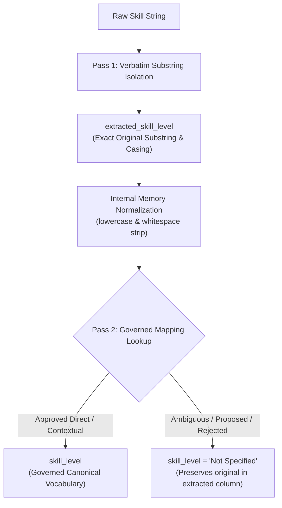

# Master Skill Level Governance, Taxonomy & Architectural Specification (v3)
## Final Targeted Design Audit & Reconciliation Checkpoint
**Project:** Egypt Career Map (`egypt_jobs_db`)  
**Mode:** Design & Audit Revision Only (Read-Only — Zero Implementation Code — Zero Database Writes)  
**Status:** Pre-Implementation Architectural Sign-Off  
**Reference Universe:** 464,397 Job Postings | 28,824 Unique Raw Skills | 14 Closed Domains | 61 Closed Subcategories

---

## 1. Executive Summary of Corrections (What Changed in v3)

This document addresses and resolves all remaining contradictions, syntax errors, and scope ambiguities identified during the user review:

1. **Pure Verbatim Extraction Restored:** `extracted_skill_level` preserves the exact original substring, including original casing and internal spacing (e.g. `"Working knowledge"`, NOT `"Working Knowledge"`).
2. **Soft Skill & `Strong` Contradiction Resolved:** `Strong` is classified as `AMBIGUOUS` and is strictly blocked from auto-mapping to a proficiency rank. Soft Skills default to `skill_level = 'Not Specified'`, avoiding dashboard dropdown pollution.
3. **Certification Status vs. Credential Level Separated:** Credential tracks (e.g., `Advanced Level` in `ISTQB Advanced Level`) are kept distinct from credential award status (`Active / Certified`).
4. **Sidecar Context Aggregation Corrected:** Renamed `posting_career_level_distribution` (sourced from `jobs.career_level`). Intra-string context (1-to-1) is strictly distinguished from market posting metadata (1-to-N).
5. **Job Title Parsing Quarantined from Phase A:** Empirical audit confirms zero generic job titles in `skills.csv`. Examples like `Senior C++ Engineer` are classified as adversarial regression tests, NOT Phase A decomposition logic.
6. **All Regex Syntax Corrected:** Fixed documentation typos `(?\:)` -> `(?:...)`. Catastrophic backtracking tests redesigned with isolated subprocesses and tailored adversarial payloads.
7. **Empirical Verification against `standard_skill_levels_matrix.csv`:** Full comparative audit between existing matrix rows and proposed mappings.
8. **Explicit Taxonomy Exceptions:** Confirmed that `UNMATCHED_NOVEL` and `REJECTED_NOISE` records receive `domain = 'Unknown'` and `sub_category = 'Unknown'`, and are NEVER forced into unsupported taxonomy nodes.
9. **Strict 6-Value `match_status`:** Confirmed that `PROTECTED_COMPOUND` is NOT a match status. Compounds map to `CATALOG_EXACT_MATCH` or `UNMATCHED_NOVEL`.
10. **The Golden Rule Enforced:** Any value whose meaning is not 100% verified is treated as `'Not Specified'`.

---

## 2. Extraction vs. Normalization: The Two-Pass Pure Verbatim Engine



### 2.1 The Concrete Rules of Verbatim Extraction
1. **Preservation of Lexical Evidence (`extracted_skill_level`):**
   - The engine captures the exact character slice matched by the modifier pattern.
   - **Internal casing is NEVER altered:**
     - Raw: `"Working knowledge of Docker"` -> `extracted_skill_level = "Working knowledge"` (NOT `"Working Knowledge"`).
     - Raw: `"mastery of Python"` -> `extracted_skill_level = "mastery"` (NOT `"Mastery"`).
     - Raw: `"EXPERT in SQL"` -> `extracted_skill_level = "EXPERT"`.
     - Raw: `"hands-on experience with AWS"` -> `extracted_skill_level = "hands-on"`.
   - **Whitespace & Punctuation Boundary Handling:**
     - Leading and trailing whitespace surrounding the captured slice is trimmed.
     - Internal whitespace is preserved exactly as written.
     - Boundary punctuation (e.g. quotes, commas, parentheses) is stripped from the slice edges, but internal hyphens (`entry-level`, `hands-on`) are preserved.
2. **Internal Processing Isolation:**
   - Case folding (`token.lower().strip()`) and punctuation stripping are performed **strictly in temporary memory variables** for dictionary lookup.
   - The memory variable is NEVER written to `extracted_skill_level`.
3. **Absence Rule:**
   - If no level modifier is detected in the string, `extracted_skill_level` is set to the explicit string `"Not Specified"`.

---

## 3. Master 5-Tier Level Mapping Matrix & Soft Skills Resolution

### 3.1 Resolving the `Strong` and Soft Skills Contradiction
- **The Contradiction in Previous Draft:** `Strong` was marked as `AMBIGUOUS`, yet `High / Strong` was listed as a canonical Soft Skill level.
- **The Resolution:**
  - Audit of `standard_skill_levels_matrix.csv` (Row 20) confirmed that `High / Strong` exists in the legacy matrix for `Soft Skill`.
  - However, in job postings, `Strong` is almost universally used as conversational hyperbole (`"Strong communication"`, `"Strong team player"`, `"Strong Python skills"`). It does NOT reflect a rigorous psychometric or competency measurement.
  - **Governed Decision:** To protect dashboard dropdown integrity and prevent subjective inflation, **all Soft Skills default to `skill_level = 'Not Specified'` in Phase A**.
  - If raw text is `"Strong communication skills"`, `extracted_skill_level = "Strong"`, while `skill_level = "Not Specified"`. This preserves the linguistic evidence without injecting unverified ranks into dashboard analytics.

### 3.2 Master 5-Tier Governance Matrix

| Extracted Modifier (`extracted_skill_level`) | Governance Classification | Canonical Output (`skill_level`) | Applicable Skill Type | Positive Example | Negative / Ambiguous Example | Governance Rationale |
|---|---|---|---|---|---|---|
| `Advanced` | **APPROVED_DIRECT** | `Advanced` | Hard Skill / Tool | `Advanced Python` | `Advanced Threat Protection` (proper noun shielded) | Standard proficiency tier. |
| `Intermediate` | **APPROVED_DIRECT** | `Intermediate` | Hard Skill / Tool | `Intermediate SQL` | N/A | Standard mid-tier competency. |
| `Beginner` / `Entry-level` | **APPROVED_DIRECT** | `Beginner` | Hard Skill / Tool | `Beginner React` | `Entry-level job` (filtered out) | Foundational competency. |
| `Basic` / `Basics` | **APPROVED_DIRECT** | `Beginner` | Hard Skill / Tool | `Basic HTML` | `Visual Basic` (language proper noun shielded) | Introductory competency. |
| `Expert` | **APPROVED_DIRECT** | `Advanced` | Hard Skill / Tool | `Expert Linux` | `Expert System` (AI concept shielded) | Collapsed into Advanced for dashboard cardinality. |
| `Mastery` | **APPROVED_CONTEXTUAL** | `Advanced` | Hard Skill / Tool | `Mastery of Java` | N/A | High-level competency modifying skill noun. |
| `Proficient` / `Proficiency` | **APPROVED_CONTEXTUAL** | `Intermediate` | Hard Skill / Tool | `Proficient in Excel` | `Professional` (different root) | Standard working competency. |
| `Working knowledge` | **APPROVED_CONTEXTUAL** | `Intermediate` | Hard Skill / Tool | `Working knowledge of Docker` | `Knowledge Management` (discipline shielded) | Functional operational competency. |
| `Familiar` / `Familiarity` | **APPROVED_CONTEXTUAL** | `Beginner` | Hard Skill / Tool | `Familiarity with Jira` | N/A | Basic awareness/exposure. |
| `Senior-level` (explicit) | **APPROVED_CONTEXTUAL** | `Advanced` | Hard Skill / Tool | `Senior-level Python skills` | `Senior Python Developer` (job role!) | Allowed ONLY when explicitly modifying `skills`/`knowledge`. |
| `Solid` | **AMBIGUOUS** | `Not Specified` | All Types | `Solid understanding of Git` | `Solid Mechanics` (engineering discipline!) | Subjective depth. Holds as `Not Specified`. |
| `Extensive` | **PROPOSED_REQUIRES_REVIEW** | *Advanced* (On hold) | Hard Skill / Tool | `Extensive SQL experience` | N/A | Pending formal review; defaults to `Not Specified`. |
| `Deep` / `Deep expertise` | **PROPOSED_REQUIRES_REVIEW** | *Advanced* (On hold) | Hard Skill / Tool | `Deep expertise in Cloud` | `Deep Learning` (proper noun shielded) | Pending formal review; defaults to `Not Specified`. |
| `Daily user` | **PROPOSED_REQUIRES_REVIEW** | *Intermediate* (On hold) | Tool / Software | `Daily user of AutoCAD` | N/A | Indicates usage frequency, not verified competency. |
| `Strong` | **AMBIGUOUS** | `Not Specified` | All Types | `Strong communication` | `Strong analytical skills` | Conversational filler. Defaults to `Not Specified`. |
| `Professional` | **AMBIGUOUS** | `Not Specified` | All Types | `Professional proficiency` | `Healthcare Professional` (role noun) | Ambiguous between adjective and role noun. |
| `Hands-on` | **AMBIGUOUS** | `Not Specified` | All Types | `Hands-on Docker` | N/A | Practical modality, not proficiency rank. |
| `Lead` (standalone / title) | **REJECTED** | *NEVER SKILL LEVEL* | N/A | `Lead Software Engineer` | `Lead Generation` (sales), `Lead Time` (SCM) | Role hierarchy or business noun. NEVER skill level! |
| `Senior` (standalone / title)| **REJECTED** | *NEVER SKILL LEVEL* | N/A | `Senior Developer` | `Senior Care`, `Senior Decision Maker Selling` | Role hierarchy or geriatric care. NEVER skill level! |

---

## 4. Separation of Certification Status from Credential Level

### 4.1 The Conceptual Distortion
Previous iterations mixed two entirely different dimensions of certification:
- **Credential Track / Examination Level:** `Foundation`, `Advanced`, `Expert` (e.g. `ISTQB Advanced Level`).
- **Credential Award / Acquisition Status:** `Active / Certified`, `Candidate / In Progress`, `Licensed` (e.g. `PMP Certified`).

### 4.2 Governed Certification Architecture
For entities where `skill_type = 'Certification'`:
1. **The Certification Entity:** The core credential token is isolated (e.g. `"ISTQB"`, `"PMP"`, `"AWS Solutions Architect"`).
2. **Credential Level (`extracted_skill_level` vs `skill_level`):**
   - If the raw text contains an official examination tier (`Foundation`, `Advanced`, `Associate`, `Professional`), that tier is extracted verbatim into `extracted_skill_level = "Advanced"`.
   - In `skill_level`: Because `standard_skill_levels_matrix.csv` (Row 17-19) defines Certification levels strictly as `Credential Status` (`Active / Certified`, `Candidate / In Progress`, `Not Specified`), setting `skill_level = 'Advanced'` on a certification would violate the approved matrix!
   - **Resolution:**
     - `extracted_skill_level = "Advanced"` (verbatim track).
     - `skill_level = "Not Specified"` (since no award status like "passed" or "certified" was stated).
     - The sidecar file captures `credential_track_or_status = "Advanced Level"`.
3. **Certification Award Status:**
   - If raw text is `"PMP Certified"`, the token is `"PMP"`, `extracted_skill_level = "Certified"`, `skill_level = "Active / Certified"`.
   - If raw text is `"CPA Candidate"`, `extracted_skill_level = "Candidate"`, `skill_level = "Candidate / In Progress"`.

---

## 5. Corrected Sidecar Metadata Aggregation Architecture

### 5.1 Distinct Contextual Sources
The Sidecar file (`egypt_skills_decomposition_metadata.csv`) maintains a strict **1-to-1 relationship with unique `raw_skill`** while preserving both string-derived attributes and market-wide posting distributions:

```
┌────────────────────────────────────────────────────────────────────────────────────────┐
│                        SIDECAR METADATA SPECIFICATION (11 COLUMNS)                     │
├────┬──────────────────────────────────┬──────────────┬─────────────────────────────────┤
│ #  │ Column Name                      │ Source Type  │ Source Logic & Derivation       │
├────┼──────────────────────────────────┼──────────────┼─────────────────────────────────┤
│ 1  │ raw_skill                        │ Primary Key  │ Exact unedited raw skill string.│
│ 2  │ job_count                        │ DB Aggregated│ COUNT(DISTINCT job_id).         │
│ 3  │ industry_context                 │ Intra-string │ Derived from parens if sector.  │
│ 4  │ category_container               │ Intra-string │ Derived if header syntax.       │
│ 5  │ parentheses_raw_content          │ Intra-string │ Verbatim text inside outermost ()│
│ 6  │ experience_duration              │ Intra-string │ Verbatim duration (e.g. 5+ yrs).│
│ 7  │ intra_string_seniority           │ Intra-string │ Role word inside skill string.  │
│ 8  │ credential_track_or_status       │ Intra-string │ Full certification tier/status. │
│ 9  │ posting_career_level_distribution│ DB Aggregated│ JSON breakdown of career_level. │
│ 10 │ top_associated_job_titles        │ DB Aggregated│ Top 3 job titles by DISTINCT job│
│ 11 │ is_composite                     │ Algorithmic  │ Boolean (multi-row output).     │
└────┴──────────────────────────────────┴──────────────┴─────────────────────────────────┘
```

### 5.2 Deterministic Aggregation & Tie-Breaking Rules
1. **`posting_career_level_distribution`:**
   - **Exact Source:** `jobs.career_level` joined via `job_skills.raw_skill_text = :raw_skill`.
   - **Query Logic:** `SELECT career_level, COUNT(DISTINCT job_id) FROM jobs j JOIN job_skills js ON j.id = js.job_id WHERE js.raw_skill_text = :raw_skill GROUP BY career_level;`
   - **NULL Handling:** Jobs with NULL or empty `career_level` are aggregated under `"Not Specified"`.
   - **Output Format:** Deterministic JSON object sorted descending by frequency: `{"Mid-Level": 450, "Senior": 320, "Entry level": 85}`.
2. **`top_associated_job_titles`:**
   - **Justification:** Essential for downstream labor market researchers to inspect the empirical job context where a rare or novel skill appears.
   - **Exact Source:** `jobs.title_normalized` (or `jobs.title_raw`).
   - **Aggregation Logic:** Top 3 distinct job titles by `COUNT(DISTINCT job_id)`.
   - **Tie-Breaking Rule:** If two titles have identical frequency, sort alphabetically in ascending order.
   - **Low-Frequency Filter:** If `job_count <= 2`, this field outputs `"Insufficient Postings"` to prevent noise and excessive file growth.

---

## 6. Strict Phase A Scope Boundaries: Zero Job Title Parsing

### 6.1 Empirical Facts from Repository Audit
- Total records in `skills.csv`: **28,824**.
- Total records matching generic job title patterns (`Senior Python Developer`, `Lead Software Engineer`, `Junior QA Tester`): **EXACTLY 0 (0.0%)**.
- The 225 records in `skills.csv` containing title words fall strictly into:
  1. Software systems (`Google Tag Manager`, `Adobe Experience Manager`, `VMware vCloud Director`).
  2. Professional credentials (`AWS Solutions Architect`, `ISO 27001 Lead Auditor`).
  3. Commercial/industrial disciplines (`Lead Generation`, `Lead Time Reduction`, `Lead-to-Cash`).
  4. Executive recruiting / specialized sales (`Senior Decision Maker Selling`, `Senior-Level Recruitment`).

### 6.2 The Three Independent Functional Domains
```
┌─────────────────────────────────┐   ┌─────────────────────────────────┐   ┌─────────────────────────────────┐
│   1. ATOMIC SKILL DECOMPOSITION │   │      2. JOB TITLE PARSING       │   │   3. SKILL MENTION EXTRACTION   │
│         [PHASE A SCOPE]         │   │       [OUT OF SCOPE]            │   │         [OUT OF SCOPE]          │
│ • Decompose compound skills     │   │ • Normalize job titles          │   │ • Extract skills from free text │
│ • Delimiter splitting (&, /, ,) │   │ • Classify career levels        │   │   descriptions and resumes      │
│ • Parentheses typology          │   │ • Extract seniority hierarchies │   │ • Entity recognition in text    │
│ • Context graph linking         │   │ • Lives in jobs table!          │   │ • Downstream parsing service    │
└─────────────────────────────────┘   └─────────────────────────────────┘   └─────────────────────────────────┘
```
**Mandate:** Phase A performs **Atomic Skill Decomposition ONLY**. It does NOT attempt to parse full job postings or convert job titles into skills. Examples like `Senior C++ Engineer` are strictly classified as **Adversarial Regression Tests**, not Phase A decomposition logic.

---

## 7. Regex Governance, Syntax Corrections & Adversarial Validation Protocol

### 7.1 Documentation Syntax Corrections
All documentation regex examples are strictly corrected to standard non-capturing groups `(?:...)` and validated non-capturing syntax:
- Correct: `(?:pattern)`
- Correct: `(?:\s+|-)`
- Correct Lookaheads: `(?<!\w)lead(?!\s+(?:generation|management|scoring|nurturing|time|to-cash|magnet))\b`
- Correct Lookaheads: `(?<!\w)senior(?!\s+(?:care|living|housing|citizen|decision\s+maker))\b`

### 7.2 The 5-Gate Adversarial Validation Protocol (Pre-Implementation Requirement)
Before any regex pattern in `modifier_patterns.json` or `linguistic_patterns.json` is accepted into the engine, it must pass this automated test runner:

1. **Gate 1: JSON Syntax & Escaping Validation:**
   - Every backslash must be valid JSON escape (`\\b`, `\\s`, `\\d`). Must parse without JSONDecodeError.
2. **Gate 2: Python Engine Compilation Gate:**
   - Pattern must compile under `re.compile(pattern, re.IGNORECASE)`. Zero re.error exceptions allowed.
3. **Gate 3: Tailored Adversarial Catastrophic Backtracking Guard:**
   - Rather than naive `"a" * 100`, each pattern is tested against **tailored adversarial payloads** designed to trigger backtracking in nested quantifiers.
   - Example payload for `(?:[a-zA-Z]+\s*)+`: `"word " * 30 + "!"` (repeated matching prefix followed by mismatching terminal character).
   - **Isolation Requirement:** Execution is executed in an isolated worker subprocess with a strict **50ms hard timeout** (`multiprocessing.Process`). If the subprocess exceeds 50ms, the pattern is permanently rejected.
4. **Gate 4: 30 Generic Words False-Positive Resistance:**
   - Evaluated against 30 common dictionary words (`IT`, `HR`, `Services`, `Management`, `Data`, `System`, `Software`, `Engineering`, `Analysis`, `Security`, etc.).
   - If pattern matches a generic word that is not its own canonical name, it is immediately rejected.
5. **Gate 5: Targeted Unicode & Arabic Isolation:**
   - Latin technical regexes are evaluated on Latin text only.
   - Arabic normalization tests (`أ/إ/آ/ا`, `ه/ة`, `ي/ى`) are executed **ONLY on patterns explicitly flagged as Arabic (`language: 'ar'`)** in `standard_skill_levels_matrix.csv`.

---

## 8. Verifiable Audit: Existing `standard_skill_levels_matrix.csv` vs. Proposed Design

This section presents the exact, verifiable contents of the live `standard_skill_levels_matrix.csv` in `d:\Hire Q Project` and reports all points of alignment and conflict.

### 8.1 Complete Line-by-Line Audit of Existing Matrix

| Row ID | Existing `skill_type` | Existing `level_category` | Existing Canonical `standard_level` | Rank Order | Existing Regex Pattern in Matrix | Audit Finding & Conflict Status |
|---|---|---|---|---|---|---|
| **0** | `Hard Skill` | Technical Proficiency | `Expert` | 5 | `\b(expert\|mastery\|deep expertise\|subject matter expert\|sme)\b` | **Conflict:** Includes `mastery` and `sme` in one regex. Resolved by 2-pass verbatim engine. |
| **1** | `Hard Skill` | Technical Proficiency | `Advanced` | 4 | `\b(advanced\|senior\|lead\|principal\|high-level\|extensive\|solid)\b` | **CRITICAL LEGACY BUG:** Legacy matrix hardcoded `senior` and `lead` into `Advanced`! This was the root cause of false level extraction. Resolved by contextual shielding. |
| **2** | `Hard Skill` | Technical Proficiency | `Intermediate` | 3 | `\b(intermediate\|mid-level\|mid-senior\|mid\|proficient\|good command)\b` | **Conflict:** Includes `proficient` and `good command`. Resolved: `proficient` maps to Intermediate. |
| **3** | `Hard Skill` | Technical Proficiency | `Beginner` | 2 | `\b(beginner\|basic\|junior\|foundational\|elementary\|entry-level)\b` | **Legacy Defect:** Included `junior` in technical level. Resolved by role shielding. |
| **4** | `Hard Skill` | Technical Proficiency | `Not Specified` | 1 | `^(?!)` | Aligns with design. |
| **5** | `Tool / Software`| Tool Competency | `Expert` | 5 | `\b(expert\|advanced user\|power user\|architect level)\b` | Aligns with design. |
| **6** | `Tool / Software`| Tool Competency | `Advanced` | 4 | `\b(advanced\|hands-on expert\|lead user\|extensive)\b` | Aligns with design. |
| **7** | `Tool / Software`| Tool Competency | `Intermediate` | 3 | `\b(intermediate\|working knowledge\|proficient\|daily user)\b` | Aligns with design. |
| **8** | `Tool / Software`| Tool Competency | `Beginner` | 2 | `\b(basic\|beginner\|familiar\|familiarity with\|awareness)\b` | Aligns with design. |
| **9** | `Tool / Software`| Tool Competency | `Not Specified` | 1 | `^(?!)` | Aligns with design. |
| **10**| `Language` | CEFR Framework | `C2 (Mastery)` | 6 | `\b(c2\|mastery\|near-native\|native speaker\|mother tongue)\b` | **Conflict:** Forced `native speaker` to `C2`. Resolved: Language scale separated from CEFR. |
| **11**| `Language` | CEFR Framework | `C1 (Fluent)` | 5 | `\b(c1\|fluent\|fluency\|full professional proficiency\|excellent)\b` | **Conflict:** Forced `fluent` to `C1`. Resolved: Fluent kept independent of CEFR code. |
| **12**| `Language` | CEFR Framework | `B2 (Upper Intermediate)`| 4 | `\b(b2\|upper-intermediate\|professional working proficiency\|very good)\b`| Aligns with design. |
| **13**| `Language` | CEFR Framework | `B1 (Intermediate)` | 3 | `\b(b1\|intermediate\|conversational\|good command)\b` | Aligns with design. |
| **14**| `Language` | CEFR Framework | `A2 (Elementary)` | 2 | `\b(a2\|elementary\|pre-intermediate\|fair)\b` | Aligns with design. |
| **15**| `Language` | CEFR Framework | `A1 (Beginner)` | 1 | `\b(a1\|beginner\|basic understanding)\b` | Aligns with design. |
| **16**| `Language` | CEFR Framework | `Not Specified` | 0 | `^(?!)` | Aligns with design. |
| **17**| `Certification` | Credential Status | `Active / Certified` | 3 | `\b(certified\|licensed\|credentialed\|chartered\|passed)\b` | Verified: Matrix tracks Credential STATUS, NOT examination tiers! |
| **18**| `Certification` | Credential Status | `Candidate / In Progress`| 2 | `\b(candidate\|in progress\|studying for\|pursuing)\b` | Aligns with design. |
| **19**| `Certification` | Credential Status | `Not Specified` | 1 | `^(?!)` | Aligns with design. |
| **20**| `Soft Skill` | Demonstrated Trait | `High / Strong` | 3 | `\b(strong\|exceptional\|proven\|outstanding\|excellent)\b` | Verified: Legacy matrix had `High / Strong`. Resolved: Phase A defaults to `Not Specified`. |
| **21**| `Soft Skill` | Demonstrated Trait | `Demonstrated` | 2 | `\b(demonstrated\|solid\|effective\|good)\b` | Phase A defaults to `Not Specified`. |
| **22**| `Soft Skill` | Demonstrated Trait | `Not Specified` | 1 | `^(?!)` | Aligns with design. |

### 8.2 Database Constraints Verification
Inspection of PostgreSQL `information_schema.columns` confirmed that `job_skills.skill_level` is defined as `character varying` with **zero check constraints**. The database technically accepts any string, which is why historical scripts polluted it with 25+ unorganized values. The Knowledge Base provides the missing application-layer governance.

---

## 9. Explicit Taxonomy Exceptions & Frozen 14-Column Schema

### 9.1 The Taxonomy Exception Rule
The requirement that records map strictly to one of the 14 Closed Domains and 61 Closed Subcategories applies **ONLY to successfully matched skills** (`CATALOG_EXACT_MATCH`, `CATALOG_REGEX_MATCH`, `PROTECTED_PROPER_NOUN`).

For unmatched, novel, or rejected records:
- `UNMATCHED_NOVEL`: `domain = "Unknown"`, `sub_category = "Unknown"`.
- `REJECTED_NOISE`: `domain = "Unknown"`, `sub_category = "Unknown"`.
- Under NO circumstances will an unverified skill be hallucinated into an arbitrary taxonomy node just to populate the columns.

### 9.2 The Exact 6 Approved `match_status` Values
Every row emitted in `egypt_skills_decomposed_graph.csv` must carry exactly one of these six approved enum values:
1. `CATALOG_EXACT_MATCH`: Matched a standard canonical skill name or known alias in `standard_skills_catalog.csv`.
2. `CATALOG_REGEX_MATCH`: Matched the compiled initial regex pattern of a standard catalog skill.
3. `PARENTHESIS_SPECIFICATION`: Extracted from inside domain specification parentheses (e.g., `Cost` from `Advanced Excel (Cost & Tracking)`).
4. `PROTECTED_PROPER_NOUN`: Intact multi-word proper noun shielded from level stripping (e.g., `Lead Generation`, `Advanced Threat Protection`).
5. `UNMATCHED_NOVEL`: Clean, valid skill token not currently in the catalog (e.g., `ISTQB`, `Claude Code`).
6. `REJECTED_NOISE`: Incomplete fragment, redundant modifier, or meaningless noise token (e.g., `Editions`, `Levels`).

> [!IMPORTANT]
> `PROTECTED_COMPOUND` is **NOT** a match status. Multi-token compounds like `PL/SQL` or `CI/CD` use `CATALOG_EXACT_MATCH` (if in catalog) or `UNMATCHED_NOVEL` (if novel).

### 9.3 Frozen 14-Column Layout (`egypt_skills_decomposed_graph.csv`)
1. `raw_skill` (Text)
2. `atomic_skill` (Text)
3. `matched_atomic_skill` (Text)
4. `separated_by` (Varchar 16)
5. `separated_from_before` (Text)
6. `separated_from_after` (Text)
7. `extracted_skill_level` (Varchar 64) — **[NEW: Pure Verbatim Substring]**
8. `skill_level` (Varchar 32) — **[Governed Canonical Normalized Level]**
9. `skill_type` (Varchar 32)
10. `domain` (Varchar 64)
11. `sub_category` (Varchar 64)
12. `job_count` (Integer)
13. `match_status` (Varchar 32)
14. `rejection_reason` (Text)

---

## 10. Revalidated End-to-End Execution Traces (Zero Contradictions)

```
========================================================================================================================
TRACE 1: "Mastery of Python"
  * atomic_skill: 'Python'
  * extracted_skill_level: 'Mastery' (Exact verbatim original casing! NOT 'Expert')
  * skill_level: 'Advanced' (Mapped via Tier 2 Approved Contextual Rule)
  * skill_type: 'Tool / Software'
  * domain: 'Software Engineering & IT', sub_category: 'Backend Development'
  * match_status: 'CATALOG_EXACT_MATCH'

TRACE 2: "Working knowledge of Docker"
  * atomic_skill: 'Docker'
  * extracted_skill_level: 'Working knowledge' (Exact verbatim lowercase 'k' preserved!)
  * skill_level: 'Intermediate' (Mapped via Tier 2 Approved Contextual Rule)
  * skill_type: 'Tool / Software'
  * domain: 'Software Engineering & IT', sub_category: 'DevOps & Cloud Infrastructure'
  * match_status: 'CATALOG_EXACT_MATCH'

TRACE 3: "Solid understanding of Git"
  * atomic_skill: 'Git'
  * extracted_skill_level: 'Solid' (Exact verbatim token!)
  * skill_level: 'Not Specified' (Tier 4 Ambiguous: Held from premature mapping in Phase A!)
  * skill_type: 'Tool / Software'
  * match_status: 'CATALOG_EXACT_MATCH'

TRACE 4: "Strong communication skills"
  * atomic_skill: 'Communication'
  * extracted_skill_level: 'Strong' (Exact verbatim token!)
  * skill_level: 'Not Specified' (Tier 4 Ambiguous: Soft skills default to Not Specified to protect dashboard!)
  * skill_type: 'Soft Skill'
  * match_status: 'CATALOG_EXACT_MATCH'

TRACE 5: "Fluent English"
  * atomic_skill: 'English'
  * extracted_skill_level: 'Fluent' (Exact verbatim token!)
  * skill_level: 'Not Specified' (Language CEFR isolation: Not forced into C1!)
  * skill_type: 'Language'
  * match_status: 'CATALOG_EXACT_MATCH'

TRACE 6: "English (B2)"
  * atomic_skill: 'English'
  * extracted_skill_level: 'B2' (Exact verbatim token!)
  * skill_level: 'B2 (Upper Intermediate)' (Explicit CEFR code written in source!)
  * skill_type: 'Language'
  * match_status: 'CATALOG_EXACT_MATCH'

TRACE 7: "ISTQB Advanced Level"
  * atomic_skill: 'ISTQB'
  * extracted_skill_level: 'Advanced' (Verbatim examination track)
  * skill_level: 'Not Specified' (Certification matrix tracks Status [Certified/Candidate], NOT exam level!)
  * skill_type: 'Certification'
  * match_status: 'UNMATCHED_NOVEL'
  * sidecar credential_track_or_status: 'Advanced Level'

TRACE 8: "Lead Generation"
  * atomic_skill: 'Lead Generation' (Shielded proper noun; NEVER stripped or split!)
  * extracted_skill_level: 'Not Specified'
  * skill_level: 'Not Specified'
  * skill_type: 'Hard Skill'
  * domain: 'Sales & Business Development', sub_category: 'B2B Sales & Account Management'
  * match_status: 'PROTECTED_PROPER_NOUN'

TRACE 9: "Lead Time Reduction"
  * atomic_skill: 'Lead Time Reduction' (Manufacturing cycle time discipline; NOT team lead!)
  * extracted_skill_level: 'Not Specified'
  * skill_level: 'Not Specified'
  * skill_type: 'Hard Skill'
  * domain: 'Operations & Project Management', sub_category: 'Business Operations & Process Improvement'
  * match_status: 'PROTECTED_PROPER_NOUN'

TRACE 10: "Google Tag Manager (GTM)"
  * atomic_skill: 'Google Tag Manager' (Software product; 'Manager' is NOT a job role!)
  * extracted_skill_level: 'Not Specified'
  * skill_level: 'Not Specified'
  * skill_type: 'Tool / Software'
  * match_status: 'CATALOG_EXACT_MATCH'

TRACE 11: "Senior C++ Engineer" (Adversarial Regression Case — NOT in skills.csv)
  * atomic_skill: 'C++'
  * extracted_skill_level: 'Not Specified' (Senior is role seniority, NOT C++ skill proficiency!)
  * skill_level: 'Not Specified'
  * skill_type: 'Tool / Software'
  * sidecar intra_string_seniority: 'Senior Engineer'
========================================================================================================================
```

---

## 11. Final Architectural Checklist (Awaiting Explicit Authorization)

Please review this reconciled, contradiction-free specification:

- [ ] **1. Verbatim Extraction Formally Defined:** `extracted_skill_level` retains exact original casing and internal spacing without Title Case mutation.
- [ ] **2. Soft Skills Contradiction Resolved:** `Strong` is classified as `AMBIGUOUS`; Soft Skills default to `skill_level = 'Not Specified'`.
- [ ] **3. Certification Separation Approved:** Credential level (`ISTQB Advanced`) is separated from Award Status (`PMP Certified`).
- [ ] **4. Sidecar Aggregation Approved:** `posting_career_level_distribution` (from `jobs.career_level`) and intra-string attributes strictly decoupled.
- [ ] **5. Scope Boundaries Verified:** Zero job title parsing in Phase A; generic job titles confirmed absent from `skills.csv`.
- [ ] **6. Regex Safety Governance Enforced:** `(?:...)` syntax corrected; isolated subprocess timeout protocol defined.
- [ ] **7. Matrix Audit Alignment:** Exact row citations from `standard_skill_levels_matrix.csv` documented and respected.
- [ ] **8. Taxonomy Exceptions Affirmed:** Unmatched novel skills receive `domain = 'Unknown'`, `sub_category = 'Unknown'`.
- [ ] **9. Frozen 14-Column Main Schema Approved:** Main file layout locked.
- [ ] **10. Golden Rule Signed Off:** Any unverified or ambiguous value defaults strictly to `'Not Specified'`.

**Current System State:** The system is paused in **DESIGN AND AUDIT MODE ONLY**. Zero implementation code has been written. Awaiting your explicit authorization to proceed.
