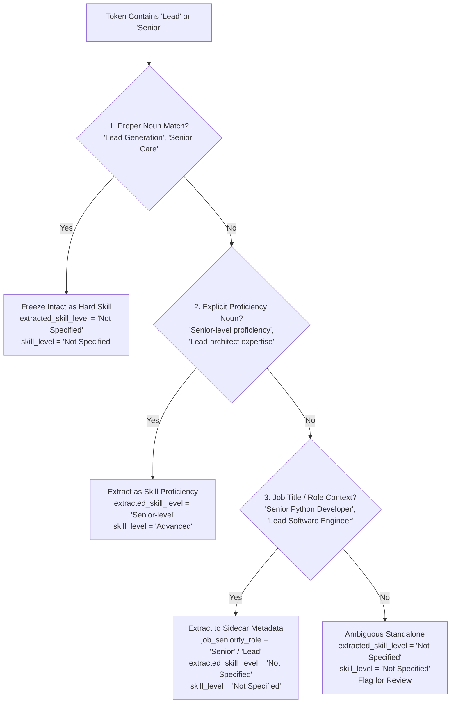

# Revised Architecture Specification: Two-Column Skill Level Governance & Semantic Seniority Disambiguation
**Project:** Egypt Career Map (`egypt_jobs_db`)  
**Status:** Architectural Design Revision Checkpoint (Design Only — Zero Code Execution)  
**Scope:** Two-Column Skill Level Refinement, Role Seniority vs Proficiency Disambiguation, Governed Mapping Dictionary

---

## 1. Architectural Assessment of the Proposed Two-Column Design

### 1.1 The Problem It Solves
Our audit of the live PostgreSQL database (`egypt_jobs_db`) revealed serious empirical evidence of level fragmentation in `job_skills.skill_level`:
- Across 464,397 records, `skill_level` currently contains an uncontrolled mixture of:
  - Canonical levels: `Advanced` (109,432), `Intermediate` (82,474), `Beginner` (11,413), `Not Specified` (145,373).
  - Synonymous adjectives: `Expert` (19,152), `Basic` (5,477), `Professional` (2,699), `Strong` (523), `Proficient` (358), `High` (323), `Excellent` (265).
  - Language CEFR grades: `Fluent` (1,626), `Native` (366), `C1` (244), `B2` (111).
  - Role seniority leaks: `Senior` (6,349), `Junior` (74).
  - Irrelevant strings: `1+ years` (88), `Experience` (39), `Preferred` (38), `null` (112).

If exposed directly to the dashboard, this produces filter dropdowns with 25+ redundant, overlapping options, destroying user experience and preventing clean analytical aggregations. Conversely, collapsing everything immediately into a single normalized column destroys data lineage, prevents auditing, and makes future recalibration impossible.

### 1.2 Evaluation of the Proposed Two-Column Architecture
Separating `extracted_skill_level` from `skill_level` provides a mathematically pure decoupling:
1. **Linguistic Fidelity (`extracted_skill_level`):** Captures the verbatim modifier as stated by the employer (e.g. "Expert", "Proficient", "Working Knowledge", "Solid"). This satisfies auditability, linguistic research, and future re-clustering without re-parsing raw text.
2. **Dashboard & Database Governance (`skill_level`):** Enforces a strictly controlled, closed enum/lookup vocabulary (`Advanced`, `Intermediate`, `Beginner`, `Not Specified` for technical skills) that powers consistent dashboard dropdowns, salary benchmarking, and career pathing.
3. **Audit Verdict:** The two-column model is **strongly endorsed**. It aligns perfectly with enterprise data warehousing best practices (preserving raw bronze/silver lineage while exposing gold canonical dimensions).

---

## 2. Revised Output Schema (Proposed 14-Column Revision)

The main decomposed graph output schema expands from 13 to 14 columns, inserting `extracted_skill_level` immediately preceding `skill_level`:

```
┌────────────────────────────────────────────────────────────────────────────────────────┐
│                        PROPOSED 14-COLUMN FROZEN GRAPH SCHEMA                          │
├────┬──────────────────────────┬──────────────┬──────────────────────────────────────────┤
│ #  │ Column Name              │ Data Type    │ Definition & Acceptable Values           │
├────┼──────────────────────────┼──────────────┼──────────────────────────────────────────┤
│ 1  │ raw_skill                │ TEXT         │ Exact unedited input string.             │
│ 2  │ atomic_skill             │ TEXT         │ Cleaned extracted atomic skill piece.    │
│ 3  │ matched_atomic_skill     │ TEXT         │ Standard catalog canonical match.        │
│ 4  │ separated_by             │ VARCHAR(16)  │ Delimiter: (), &, /, ,, -, space, None   │
│ 5  │ separated_from_before    │ TEXT         │ Textual context preceding this piece.    │
│ 6  │ separated_from_after     │ TEXT         │ Textual context succeeding this piece.   │
│ 7  │ extracted_skill_level    │ VARCHAR(64)  │ Verbatim extracted modifier as written.  │  <-- [NEW PROPOSED COLUMN]
│ 8  │ skill_level              │ VARCHAR(32)  │ Canonical normalized level (Closed Enum) │  <-- [GOVERNED CANONICAL]
│ 9  │ skill_type               │ VARCHAR(32)  │ Tool, Hard Skill, Soft Skill, Cert, Lang │
│ 10 │ domain                   │ VARCHAR(64)  │ Strictly 1 of 14 Closed Domains          │
│ 11 │ sub_category             │ VARCHAR(64)  │ Strictly 1 of 61 Closed Subcategories    │
│ 12 │ job_count                │ INTEGER      │ COUNT(DISTINCT job_id) from PostgreSQL   │
│ 13 │ match_status             │ VARCHAR(32)  │ CATALOG_EXACT_MATCH, UNMATCHED_NOVEL...  │
│ 14 │ rejection_reason         │ TEXT         │ Explanation if rejected as noise.        │
└────┴──────────────────────────┴──────────────┴──────────────────────────────────────────┘
```

> [!IMPORTANT]
> **Schema Revision Sign-Off:** Moving from 13 to 14 columns requires formal user approval. This plan documents the 14-column layout as proposed.

---

## 3. Sidecar Context Metadata Schema (Refined 9 Columns)

To honor the constraint that **job seniority is NOT skill proficiency**, role seniority modifiers (e.g. "Senior" in `Senior Python Developer` or "Lead" in `Lead Software Engineer`) must NOT pollute either `extracted_skill_level` or `skill_level`. 

Instead, the sidecar metadata export adds a dedicated `job_seniority_role` column:

| # | Column Name | Type | Description & Examples |
|---|---|---|---|
| 1 | `raw_skill` | `TEXT` | Primary key linking back to `egypt_skills_decomposed_graph.csv`. |
| 2 | `job_seniority_role` | `VARCHAR(32)` | **[NEW]** Extracted job hierarchy role: `Senior`, `Lead`, `Junior`, `Principal`, `Director`, `Head of`. |
| 3 | `category_container` | `TEXT` | Category header wrapper (e.g. `AI Development Tools`, `Caching`). |
| 4 | `industry_context` | `TEXT` | Industry restriction (e.g. `Transportation & Logistics`, `Hospitality/Leisure`). |
| 5 | `experience_duration` | `TEXT` | Years duration (e.g. `5+ years`, `3-5 years`). |
| 6 | `parentheses_raw_content`| `TEXT` | Full original text inside parentheses. |
| 7 | `is_composite` | `BOOLEAN` | Whether raw skill decomposed into multiple atomic rows. |
| 8 | `atomic_row_count` | `INTEGER` | Number of child rows produced. |
| 9 | `contains_noise` | `BOOLEAN` | Whether any fragment was rejected as noise. |

---

## 4. Controlled & Governed Level Mapping Dictionary

The engine enforces a versioned mapping dictionary (`linguistic_intelligence/vocabularies/level_mapping_dictionary.json`). The runtime engine is strictly forbidden from improvising mappings.

```json
{
  "version": "1.0.0",
  "governance": "Approved by Hire Q Architecture Team",
  "technical_proficiency_mappings": [
    {
      "extracted_pattern": "\\b(advanced|high-level|extensive|deep|solid)\\b",
      "extracted_skill_level": "Advanced",
      "canonical_skill_level": "Advanced",
      "is_unconditional": true,
      "context_conditions": null,
      "mapping_status": "APPROVED",
      "rationale": "Direct semantic identity to canonical Advanced."
    },
    {
      "extracted_pattern": "\\b(expert|mastery|sme|architect-level)\\b",
      "extracted_skill_level": "Expert",
      "canonical_skill_level": "Advanced",
      "is_unconditional": true,
      "context_conditions": null,
      "mapping_status": "APPROVED",
      "rationale": "Dashboard collapses Expert into top-tier Advanced for controlled filter cardinality."
    },
    {
      "extracted_pattern": "\\b(intermediate|mid-level|mid|proficient|working knowledge|daily user)\\b",
      "extracted_skill_level": "Intermediate",
      "canonical_skill_level": "Intermediate",
      "is_unconditional": true,
      "context_conditions": null,
      "mapping_status": "APPROVED",
      "rationale": "Standard mid-tier competency mapping."
    },
    {
      "extracted_pattern": "\\b(beginner|basic|foundational|elementary|entry-level|familiar|familiarity)\\b",
      "extracted_skill_level": "Beginner",
      "canonical_skill_level": "Beginner",
      "is_unconditional": true,
      "context_conditions": null,
      "mapping_status": "APPROVED",
      "rationale": "Introductory / basic familiarity tier."
    },
    {
      "extracted_pattern": "\\bsenior[- ]level\\s+(?:proficiency|knowledge|skills?|experience)\\b",
      "extracted_skill_level": "Senior-level",
      "canonical_skill_level": "Advanced",
      "is_unconditional": false,
      "context_conditions": "MUST_CONTAIN_EXPLICIT_PROFICIENCY_NOUN",
      "mapping_status": "APPROVED",
      "rationale": "Explicitly describes skill proficiency rather than job title role."
    }
  ],
  "language_cefr_mappings": [
    {"extracted_pattern": "\\b(c2|native|near-native|mother tongue)\\b", "extracted": "C2 (Mastery)", "canonical": "C2 (Mastery)"},
    {"extracted_pattern": "\\b(c1|fluent|fluency|full professional)\\b", "extracted": "C1 (Fluent)", "canonical": "C1 (Fluent)"},
    {"extracted_pattern": "\\b(b2|upper-intermediate|very good)\\b", "extracted": "B2 (Upper Intermediate)", "canonical": "B2 (Upper Intermediate)"},
    {"extracted_pattern": "\\b(b1|intermediate|conversational|good)\\b", "extracted": "B1 (Intermediate)", "canonical": "B1 (Intermediate)"},
    {"extracted_pattern": "\\b(a2|elementary|pre-intermediate|fair)\\b", "extracted": "A2 (Elementary)", "canonical": "A2 (Elementary)"},
    {"extracted_pattern": "\\b(a1|beginner|basic)\\b", "extracted": "A1 (Beginner)", "canonical": "A1 (Beginner)"}
  ]
}
```

---

## 5. Contextual Decision Rules for "Senior", "Lead", "Expert", and "Proficient"



### 5.1 Rule Set 1: Proper Noun Shield (No Level Extraction)
- **Condition:** Phrase matches `protected_proper_nouns.json`.
- **Examples:** `Lead Generation`, `Lead Management`, `Lead Nurturing`, `Senior Care`, `Senior Living`.
- **Output:**
  - `extracted_skill_level` = `'Not Specified'`
  - `skill_level` = `'Not Specified'`
  - `atomic_skill` = Full proper noun intact.

### 5.2 Rule Set 2: Job Role Seniority (Preserve in Sidecar, NOT in Skill Level)
- **Condition:** "Senior" or "Lead" precedes a professional role/title (`Developer`, `Engineer`, `Architect`, `Consultant`, `Analyst`, `Specialist`, `Manager`) or technical noun without explicit proficiency wording.
- **Examples:** `Senior Python Developer`, `Lead Software Engineer`, `Lead DevOps Engineer`.
- **Output:**
  - `atomic_skill` = `'Python'` (or `'Python Developer'`), `'Software Engineering'`
  - `extracted_skill_level` = `'Not Specified'` (Seniority is NOT technical proficiency!)
  - `skill_level` = `'Not Specified'`
  - **Sidecar Metadata:** `job_seniority_role = 'Senior'` / `job_seniority_role = 'Lead'`

### 5.3 Rule Set 3: Explicit Proficiency Attribution (Normalized to Canonical)
- **Condition:** "Senior" or "Lead" explicitly modifies competency nouns (`proficiency`, `knowledge`, `expertise`, `experience`).
- **Examples:** `Senior-level Python proficiency`, `Lead-level systems architecture knowledge`.
- **Output:**
  - `extracted_skill_level` = `'Senior-level'`
  - `skill_level` = `'Advanced'` (Mapped via governed dictionary rule)

### 5.4 Rule Set 4: High-Proficiency Adjectives (Expert, Proficient, Solid)
- **Examples:** `Expert Python`, `Proficient in Excel`, `Solid SQL`.
- **Output:**
  - `Expert Python` -> `extracted_skill_level = 'Expert'`, `skill_level = 'Advanced'`
  - `Proficient Excel` -> `extracted_skill_level = 'Proficient'`, `skill_level = 'Intermediate'`
  - `Solid SQL` -> `extracted_skill_level = 'Solid'`, `skill_level = 'Intermediate'`

---

## 6. End-to-End Execution Traces (Two-Column Output)

```
========================================================================================================================
CASE 1: Advanced Threat Protection
  * atomic_skill: 'Advanced Threat Protection'
  * extracted_skill_level: 'Not Specified'
  * skill_level: 'Not Specified'
  * skill_type: 'Hard Skill'
  * sidecar job_seniority_role: null
  * Rationale: Proper noun cybersecurity discipline; "Advanced" is not a proficiency level.

CASE 2: GitHub Advanced Security
  * atomic_skill: 'GitHub Advanced Security'
  * extracted_skill_level: 'Not Specified'
  * skill_level: 'Not Specified'
  * skill_type: 'Tool / Software'
  * sidecar job_seniority_role: null
  * Rationale: Proper product name; "Advanced" is brand identity, not user level.

CASE 3: Advanced Python
  * atomic_skill: 'Python'
  * extracted_skill_level: 'Advanced'
  * skill_level: 'Advanced'
  * skill_type: 'Tool / Software'
  * sidecar job_seniority_role: null
  * Rationale: Direct adjective modification of tool competency.

CASE 4: Expert Python
  * atomic_skill: 'Python'
  * extracted_skill_level: 'Expert'
  * skill_level: 'Advanced'
  * skill_type: 'Tool / Software'
  * sidecar job_seniority_role: null
  * Rationale: "Expert" extracted verbatim; mapped to dashboard canonical "Advanced".

CASE 5: Proficient Excel
  * atomic_skill: 'Excel' (matched: 'Microsoft Excel')
  * extracted_skill_level: 'Proficient'
  * skill_level: 'Intermediate'
  * skill_type: 'Tool / Software'
  * sidecar job_seniority_role: null
  * Rationale: "Proficient" maps to mid-tier Intermediate in canonical matrix.

CASE 6: Senior Python Developer
  * atomic_skill: 'Python' (or 'Python Developer')
  * extracted_skill_level: 'Not Specified'
  * skill_level: 'Not Specified'
  * skill_type: 'Tool / Software'
  * sidecar job_seniority_role: 'Senior'
  * Rationale: Senior describes job role, NOT Python skill level. Preserved in sidecar.

CASE 7: Lead Software Engineer
  * atomic_skill: 'Software Engineering'
  * extracted_skill_level: 'Not Specified'
  * skill_level: 'Not Specified'
  * skill_type: 'Hard Skill'
  * sidecar job_seniority_role: 'Lead'
  * Rationale: Lead describes organizational leadership/rank. Preserved in sidecar.

CASE 8: Senior-level Python proficiency
  * atomic_skill: 'Python'
  * extracted_skill_level: 'Senior-level'
  * skill_level: 'Advanced'
  * skill_type: 'Tool / Software'
  * sidecar job_seniority_role: null
  * Rationale: Explicit proficiency phrasing modifies Python competency.

CASE 9: Lead Generation
  * atomic_skill: 'Lead Generation'
  * extracted_skill_level: 'Not Specified'
  * skill_level: 'Not Specified'
  * skill_type: 'Hard Skill'
  * sidecar job_seniority_role: null
  * Rationale: Sales domain proper noun; "Lead" is a prospective customer.

CASE 10: Senior Care
  * atomic_skill: 'Senior Care'
  * extracted_skill_level: 'Not Specified'
  * skill_level: 'Not Specified'
  * skill_type: 'Hard Skill'
  * sidecar job_seniority_role: null
  * Rationale: Healthcare proper noun; "Senior" refers to elderly citizens.

CASE 11: ISTQB Advanced Level
  * atomic_skill: 'ISTQB'
  * extracted_skill_level: 'Advanced'
  * skill_level: 'Advanced'
  * skill_type: 'Certification'
  * sidecar job_seniority_role: null
  * Rationale: Certification level modifier cleanly separated from certification token.
========================================================================================================================
```

---

## 7. Updated Test Suite & Acceptance Assertions

| Test Case Name | Input String | Expected `atomic_skill` | Expected `extracted_skill_level` | Expected `skill_level` | Expected `job_seniority_role` (Sidecar) |
|---|---|---|---|---|---|
| **Proper Noun Test 1** | `Lead Generation` | `Lead Generation` | `Not Specified` | `Not Specified` | `null` |
| **Proper Noun Test 2** | `Lead Management` | `Lead Management` | `Not Specified` | `Not Specified` | `null` |
| **Proper Noun Test 3** | `Senior Care` | `Senior Care` | `Not Specified` | `Not Specified` | `null` |
| **Proper Noun Test 4** | `Senior Living` | `Senior Living` | `Not Specified` | `Not Specified` | `null` |
| **Proper Noun Test 5** | `Advanced Threat Protection` | `Advanced Threat Protection` | `Not Specified` | `Not Specified` | `null` |
| **Proper Noun Test 6** | `GitHub Advanced Security` | `GitHub Advanced Security` | `Not Specified` | `Not Specified` | `null` |
| **Role Seniority Test 1** | `Senior Python Developer` | `Python` | `Not Specified` | `Not Specified` | `Senior` |
| **Role Seniority Test 2** | `Lead Software Engineer` | `Software Engineering` | `Not Specified` | `Not Specified` | `Lead` |
| **Role Seniority Test 3** | `Junior QA Tester` | `QA Testing` | `Not Specified` | `Not Specified` | `Junior` |
| **Proficiency Mod Test 1** | `Advanced Python` | `Python` | `Advanced` | `Advanced` | `null` |
| **Proficiency Mod Test 2** | `Expert Python` | `Python` | `Expert` | `Advanced` | `null` |
| **Proficiency Mod Test 3** | `Proficient Excel` | `Excel` | `Proficient` | `Intermediate` | `null` |
| **Proficiency Mod Test 4** | `Basic HTML` | `HTML` | `Basic` | `Beginner` | `null` |
| **Proficiency Mod Test 5** | `Senior-level Python proficiency` | `Python` | `Senior-level` | `Advanced` | `null` |

---

## 8. Summary of Changes Compared with Previous Design

1. **Schema Revision (13 -> 14 Columns):**
   - Added `extracted_skill_level` as column 7.
   - Retained `skill_level` as column 8 (canonical normalized level).
2. **Sidecar Metadata Refinement (8 -> 9 Columns):**
   - Added `job_seniority_role` to capture role hierarchy (`Senior`, `Lead`, `Junior`) without polluting skill proficiency.
3. **Decoupled Level Mapping Dictionary:**
   - Formalized `level_mapping_dictionary.json` defining exact pattern-to-canonical mappings, rationale, and context rules.
4. **Contextual Lookahead Rule Engine:**
   - Formalized 4-branch decision tree for `Senior`, `Lead`, `Advanced`, `Expert`.
5. **Revalidated Traces:**
   - Explicit traces for `Expert Python` -> `Advanced` and `Proficient Excel` -> `Intermediate` documented.

---

## 9. Backward Compatibility & Downstream Impact

1. **PostgreSQL & Database Tables:**
   - The PostgreSQL database remains **100% READ-ONLY**. No table schema is touched.
2. **Dashboard Consumers:**
   - Any query or dashboard widget filtering on `skill_level` continues to receive the clean canonical set (`Advanced`, `Intermediate`, `Beginner`, `Not Specified`).
   - Detailed auditor dashboards can now query `extracted_skill_level` to view employer phrasing nuances.
3. **CSV Consumers:**
   - Downstream consumers expecting 13 columns must be informed that column 7 is `extracted_skill_level` and column 8 is `skill_level`.

---

## 10. Approval Checklist (Awaiting Explicit Authorization)

- [ ] **Approval Item 1:** Formally approve the 14-column output schema (insertion of `extracted_skill_level`).
- [ ] **Approval Item 2:** Formally approve the addition of `job_seniority_role` to the sidecar metadata export.
- [ ] **Approval Item 3:** Approve the canonical mapping rule collapsing `Expert` -> `Advanced` for dashboard consistency while preserving `Expert` in `extracted_skill_level`.
- [ ] **Approval Item 4:** Approve the contextual Senior/Lead rule preventing role titles from being mapped to skill proficiency.

**Status:** Paused in DESIGN REVISION AND AUDIT ONLY mode. Awaiting your review and explicit authorization.
