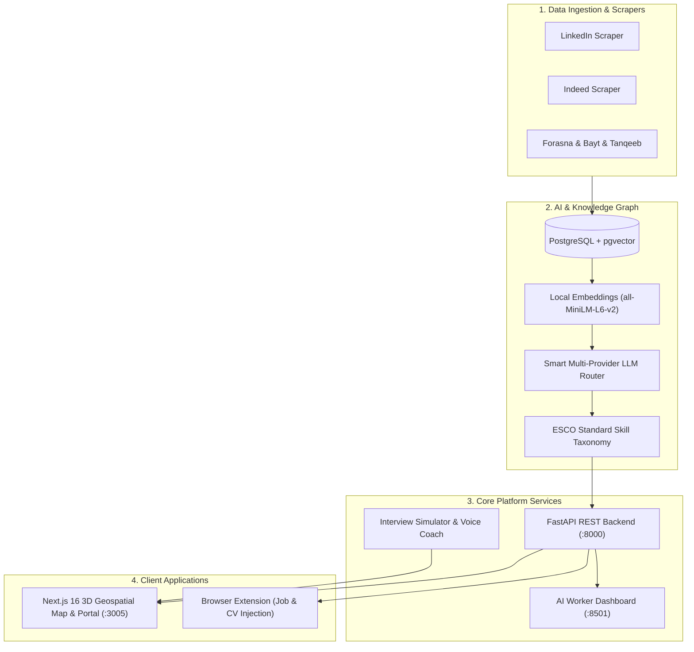

# 🚀 Hire Q — Egypt Career Intelligence & AI Platform

[](https://python.org)
[](https://fastapi.tiangolo.com)
[](https://nextjs.org)
[](https://react.dev)
[](https://www.postgresql.org)
[](https://tailwindcss.com)

**Hire Q** is an end-to-end Career Intelligence and Labor Market Mapping platform engineered specifically for the Egyptian economy. It aggregates vacancies across all major national and global job boards, extracts structured skills and salary insights via local embedding models and semantic LLMs, maps regional demand onto a 3D geospatial map, and provides candidate career simulation and CV matching.

---

## 🏛 System Architecture



---

## 📦 Core Modules

| Module | Directory | Description |
| :--- | :--- | :--- |
| **Backend API & AI Engine** | `Backend API & Integration/` | FastAPI REST services, CV matcher, OCR engine, Smart LLM Router, and database models. |
| **Frontend Web Portal** | `Frontend (Landing + Map + Auth)/frontend/` | Next.js 16, React 19, MapLibre GL 3D interactive job map, and candidate portals. |
| **Egypt Jobs Scraper** | `Egypt Jobs Scraper/` | Headless Playwright scrapers, Prisma ORM schemas, and automated job ingestors for Egyptian portals. |
| **Career Coach & Simulator** | `Interview Simulator & Career Coach/` | Rule-based and voice-orchestrated career coaching and dynamic interview simulations. |
| **ESCO Standard Taxonomy** | `ESCO_Taxonomy/` | European Standard Classification of Occupations (ESCO) mapped to the Egyptian labor market. |
| **Browser Extension** | `extension/` | Chrome extension providing real-time CV matching and vacancy analysis on live job boards. |
| **Data Dimensions** | `Data Modeling/` | Standardized dimension tables for Egyptian governorates, career levels, and work modes. |

---

## ⚡ Quick Start

### 1. Prerequisites
* **Python**: 3.10+ (64-bit)
* **Node.js**: 18.0+ & npm
* **PostgreSQL**: 14+ with database named `egypt_jobs_db`

### 2. Configuration Setup
Create your local environment file:
```bash
cp .env.example .env
```
Update `.env` with your PostgreSQL credentials and LLM provider keys.

### 3. One-Click Launch (Windows)
Run the master control panel to manage or start all microservices:
```cmd
"HireQ Control Panel.bat"
```
Or launch both the Backend and Frontend concurrently:
```cmd
run_platform.bat
```
* **Frontend Application**: `http://localhost:3005` (or `http://localhost:3000`)
* **FastAPI Docs & Swagger**: `http://localhost:8000/docs`
* **AI Worker Dashboard**: `http://localhost:8501`

---

## 🛠 Manual Installation

### Backend Setup
```bash
# Navigate to Backend
cd "Backend API & Integration"

# Create and activate virtual environment
python -m venv .venv
# Windows:
.venv\Scripts\activate
# Linux/Mac:
source .venv/bin/activate

# Install dependencies
pip install -r requirements.txt

# Start FastAPI server
python main.py
```

### Frontend Setup
```bash
# Navigate to Next.js application
cd "Frontend (Landing + Map + Auth)/frontend"

# Install packages
npm install

# Start Next.js development server
npm run dev -- -p 3005
```

### Scrapers Setup
```bash
# Navigate to Scraper directory
cd "Egypt Jobs Scraper"

# Install packages
npm install

# Generate Prisma client
npx prisma generate
```

---

## 📊 Storage & Data Strategy (GitHub vs Cloud)

To keep this Git repository lightweight, fast, and within Git limits, the repository is configured as follows:

* **In GitHub Repository:**
  * Source code, API implementations, Next.js frontend, scraper scripts.
  * Standardized taxonomies (`ESCO_Taxonomy/`), dimension schemas (`Data Modeling/`).
  * Configuration templates (`.env.example`), documentation, and launcher scripts.
* **In Cloud Storage (Google Drive):**
  * Massive raw CV datasets & Kaggle archives (`Rusumes data and model/` - 3.5 GB).
  * Video screen recordings & platform demos (`*.mp4` - 200 MB).
  * Historical scraped batch files (`parts/` - 160 MB).
  * Binary ML checkpoints & picklers (`*.pickle`, `*.pth`).
  * PowerBI report workbooks (`*.pbix`).

---

## 🔒 Security & Privacy

* **Zero-Secrets Policy**: No API keys, passwords, or live connection strings are committed.
* **Protected Files**: `.gitignore` is configured to strictly exclude `.env`, `API KEYS.xlsx`, `jobs.db`, and all credentials.
* **Personal Data Isolation**: All personal resumes and non-project case studies are isolated from version control.

---

## 📄 License
Internal proprietary project — **Hire Q Platform Team**. All rights reserved.
