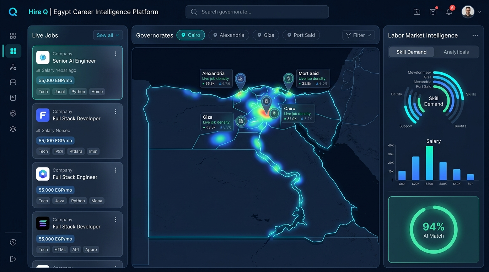
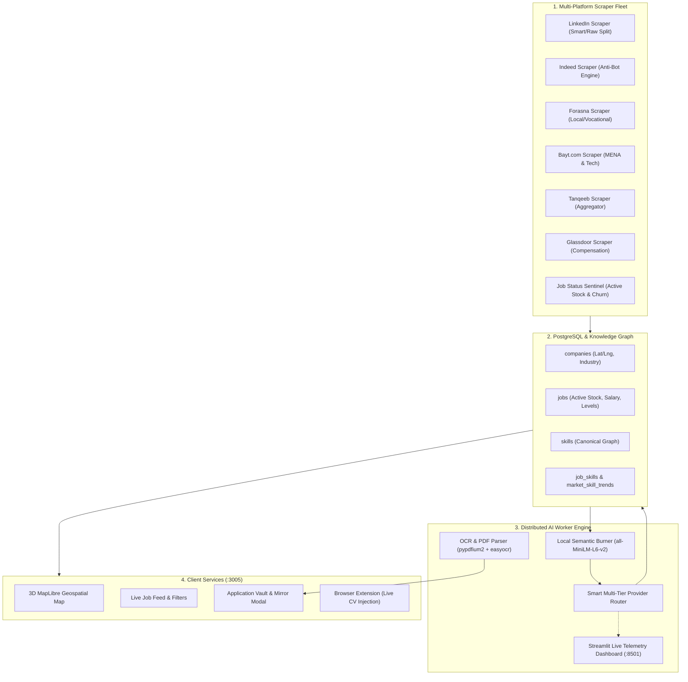
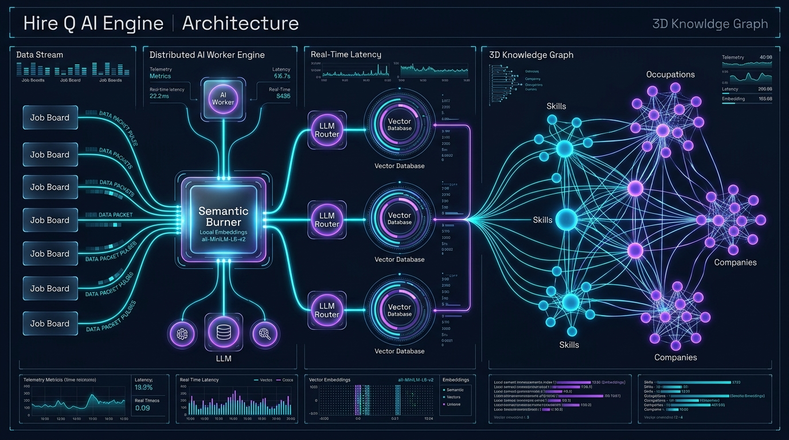
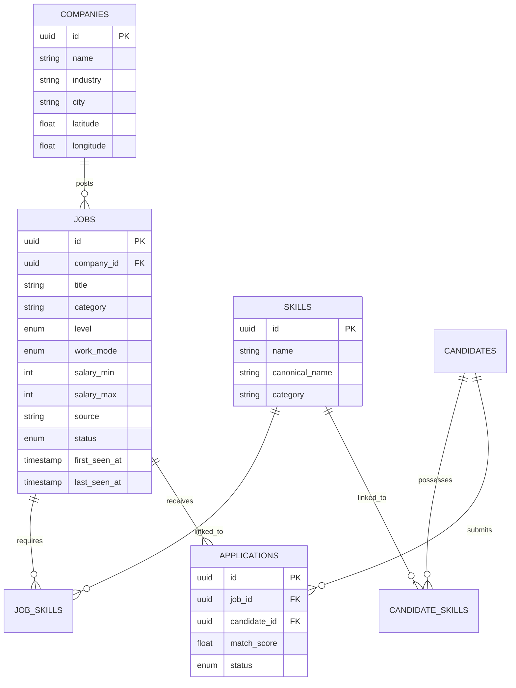

# 🚀 Egypt Career Map Platform (Hire Q)

[](https://nextjs.org)
[](https://react.dev)
[](https://fastapi.tiangolo.com)
[](https://www.postgresql.org)
[](https://python.org)
[](https://tailwindcss.com)

**Egypt Career Map Platform** is an enterprise-grade labor market intelligence and recruitment engine designed specifically for the Egyptian economy. The platform aggregates live vacancies across all national and international job boards, extracts structured skills and compensation insights via local semantic embeddings and high-performance AI workers, projects talent supply and demand onto a 3D geospatial map of Egypt, and provides instant CV-to-job matching.

---

## 🖥 Platform Interface & Experience



---

## 🏛 System Architecture Overview



---

## 🌐 Active Platform Services & Capabilities

### 1. 3D Geospatial Labor Market Map
* **Engine:** MapLibre GL 3D interactive rendering of Egypt's 27 governorates.
* **Geospatial Analytics:** Visualizes vacancy density, talent concentration, and wage disparities across Cairo, Giza, Alexandria, the Nile Delta, Canal cities, and Upper Egypt.
* **Regional Filters:** Filter by governorate, commute radius, and on-site vs remote job distribution.

### 2. Live Job Feed & Market Explorer
* **Search & Multi-Dimensional Filtering:** Filter jobs by career level (*Entry, Mid, Senior, Lead*), category (*Software, Finance, Engineering, Healthcare*), work mode (*Remote, Hybrid, On-site*), and real salary ranges.
* **Salary Estimation:** Normalizes salary offerings to monthly EGP ranges based on market averages and seniority.

### 3. Application Vault & Profile Review Mirror
* **Resume Parser & OCR:** Dual-layer extraction engine using `pypdfium2` and `easyocr` capable of extracting structured text from digital and scanned PDF resumes.
* **Skill Vectorization:** Converts candidate profiles into 384-dimensional vectors to calculate instant cosine match scores against live market opportunities.
* **Application Mirror:** Allows candidates to preview how recruiters and ATS algorithms evaluate their credentials against specific job requirements.

### 4. Chrome Extension Integration
* Injects real-time vacancy analysis, required skill badges, and candidate compatibility scores directly into active job listing pages on external portals.

---

## 🕷️ Multi-Platform Scraper Fleet

The platform features a dedicated collection engine engineered to bypass rate-limiting and bot-protection walls across all major job portals in Egypt:

| Scraper Module | Source Code | Capabilities & Strategy |
| :--- | :--- | :--- |
| **LinkedIn Scraper** | `Egypt Jobs Scraper/src/LinkedInManager.ts` | Dual-mode scraping (`smart` and `raw` splits), session rotation, automated pagination, and deep job description extraction. |
| **Indeed Scraper** | `Egypt Jobs Scraper/src/IndeedManagerV5.ts` | Undetected Playwright browser automation with stealth drivers, anti-Cloudflare protection, and Egyptian city targeting. |
| **Forasna (فرصنا)** | `Egypt Jobs Scraper/src/ForasnaManager.ts` | Targeted scraper for the Egyptian local labor market, vocational positions, entry-level, and industrial roles across all governorates. |
| **Bayt.com** | `Egypt Jobs Scraper/src/BaytManager.ts` | Regional tech and corporate listings in Cairo, Alexandria, and Giza. |
| **Tanqeeb (تنقيب)** | `Egypt Jobs Scraper/src/TanqeebManager.ts` | Local Egyptian job aggregator parsing structured multi-category vacancies. |
| **Glassdoor** | `Egypt Jobs Scraper/src/GlassdoorManager.ts` | Salary benchmarks, company reviews, and compensation ranges. |
| **Job Status Sentinel** | `Egypt Jobs Scraper/src/scrapers/JobStatusChecker.ts` | Automated heartbeat that checks expired vacancies daily to compute **Market Churn** and calculate genuine **Active Job Stock**. |

---

## 🧠 AI Worker Engine & Architecture



The AI Worker operates as an autonomous background pipeline responsible for parsing raw job descriptions into structured knowledge graph entities.

### 1. Local Semantic Burner (`all-MiniLM-L6-v2`)
* Runs locally on CPU/GPU via PyTorch and `SentenceTransformer`.
* Compares text segments against semantic requirement anchors (*mandatory skills, qualifications, tools, methodologies*).
* **Token Saver:** Filters out company marketing blurbs, equal opportunity disclaimers, and boilerplate perks **before** sending prompts to LLMs, cutting inference token consumption by up to **70%**.

### 2. Intelligent Multi-Tier Provider Router
* **Task-Aware Classification:** Classifies extraction workloads into distinct tiers (High-complexity CV analysis, standard skill extraction, and lightweight entity normalization).
* **Dynamic Load Balancing:** Dynamically distributes request volumes across available provider quotas based on active requests per minute (RPM).
* **Fault-Tolerant Cooldowns:** Automatically handles rate limits (HTTP 429) with exponential backoff and transparent failover without pipeline interruption.
* **Security & Privacy:** All provider keys, credentials, and configuration files are decoupled and excluded from version control.

### 3. Streamlit Real-Time Telemetry Dashboard
* Dedicated live monitor (`ai_dashboard.py` on port `8501`) displaying real-time worker throughput, token velocity, provider health, and extraction accuracy.

---

## 🗄️ Database Architecture & Knowledge Graph

The data foundation is built on **PostgreSQL** with relational integrity and vector capabilities:



* **`companies`**: Stores enterprise profiles and exact GPS coordinates (`latitude`, `longitude`) for 3D map projection.
* **`jobs`**: Tracks job metadata, normalized categories, seniority levels, salary bounds, and active/closed lifecycle status.
* **`skills` & `job_skills`**: Normalized skills repository modeling co-occurrence relationships and skill demand trends.
* **`candidates` & `applications`**: Candidate vector profiles and semantic match scores.

---

## ⚙️ System Requirements & Setup

### Prerequisites
* **Operating System:** Windows 10/11, Ubuntu 22.04+, or macOS
* **Python:** 3.10 or higher (64-bit)
* **Node.js:** 18.0 or higher
* **PostgreSQL:** 14+ running on port `5432` with database `egypt_jobs_db`

---

### Step 1: Environment Configuration
Copy the environment template and configure your local settings:
```bash
cp .env.example .env
```

---

### Step 2: Python Backend Installation
```bash
# Navigate to Backend directory
cd "Backend API & Integration"

# Create and activate virtual environment
python -m venv .venv
# On Windows:
.venv\Scripts\activate
# On Linux/macOS:
source .venv/bin/activate

# Install all backend dependencies
pip install -r requirements.txt

# Start FastAPI server
python main.py
```
* Backend API available at: `http://localhost:8000`
* Interactive API Documentation (Swagger): `http://localhost:8000/docs`

---

### Step 3: Frontend Web Portal Setup
```bash
# Navigate to Frontend directory
cd "Frontend (Landing + Map + Auth)/frontend"

# Install Node dependencies
npm install

# Start Next.js development server
npm run dev -- -p 3005
```
* Web Portal available at: `http://localhost:3005`

---

### Step 4: AI Telemetry Dashboard (Optional)
```bash
cd "Backend API & Integration"
streamlit run ai_dashboard.py --server.port 8501
```
* Dashboard available at: `http://localhost:8501`

---

### One-Click Launch (Windows)
You can launch the entire ecosystem simultaneously using the included control scripts:
* **`run_platform.bat`**: Concurrently starts the FastAPI Backend on port `8000` and Next.js Frontend on port `3005`.
* **`HireQ Control Panel.bat`**: Master terminal GUI for starting, stopping, and inspecting individual microservices, background workers, and database stats.

---

## 🔒 Security & Privacy Notice
* All credentials, API tokens, local databases (`*.db`), personal CVs, and scraper session cookies are protected via `.gitignore`.
* Production deployments use environment variables exclusively.

---

## 📄 License
Internal proprietary project — **Egypt Career Map Platform Team**. All rights reserved.
